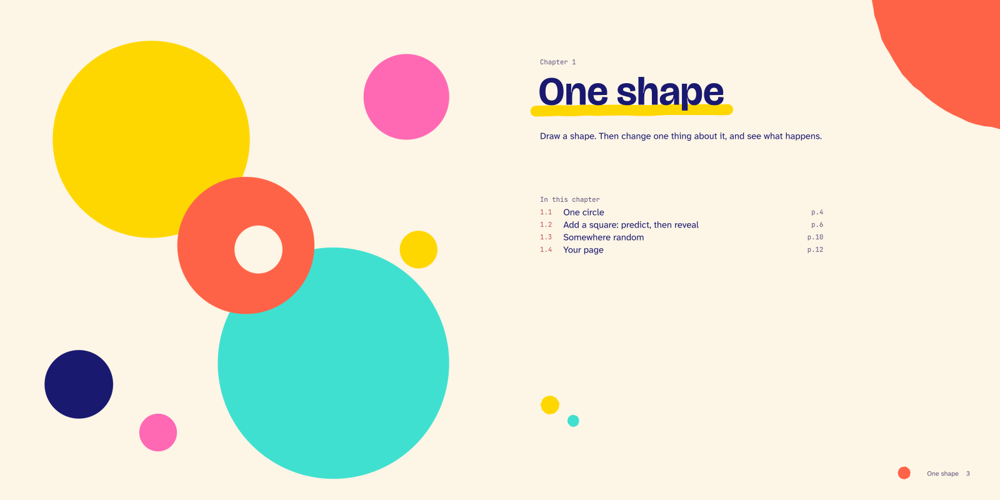

---
hide:
  - navigation
---

<nav class="fg-walk fg-walk--crumb" aria-label="Breadcrumb" markdown>

[A funground book](README.md) › Spread 1 of 6

</nav>

<nav class="fg-walk fg-walk--steps" aria-label="Previous and next spread" markdown>

[Next: 1.1 One circle ›](spread_2.md){ rel=next }

</nav>

# The opener

A picture drawn by a funground sketch, and the chapter's first page: its title, one sentence and what is in it.

**Night**, for reading on a screen:

<nav class="fg-walk fg-walk--steps" aria-label="Previous and next spread" markdown>

[All spreads](README.md) [Next: 1.1 One circle ›](spread_2.md){ rel=next }

</nav>
