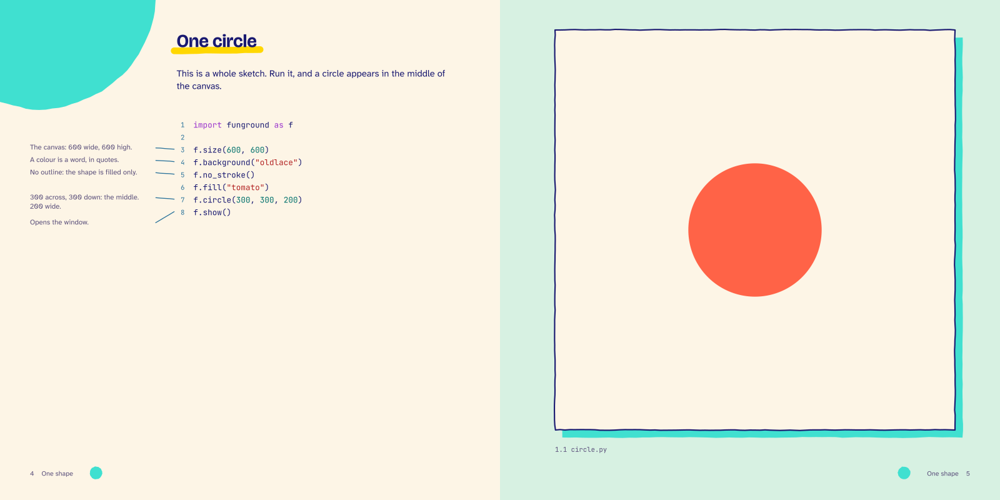
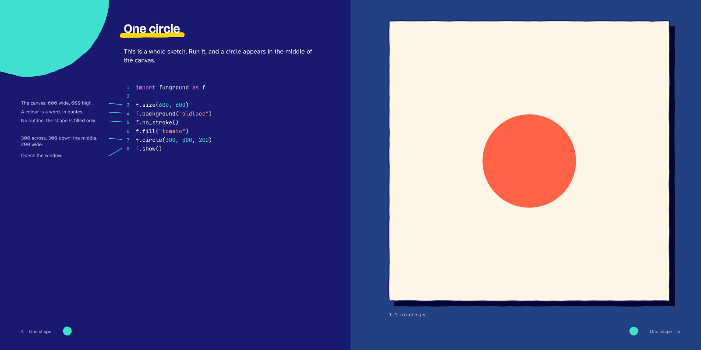
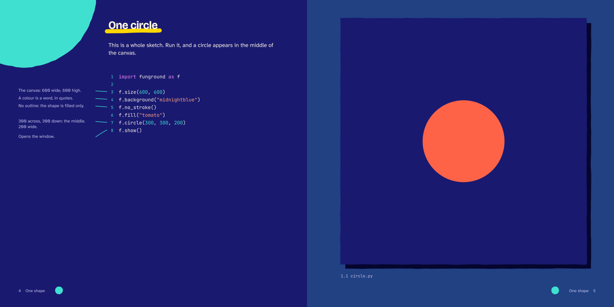

---
hide:
  - navigation
---

<nav class="fg-walk fg-walk--crumb" aria-label="Breadcrumb" markdown>

[A funground book](README.md) › Spread 2 of 6

</nav>

<nav class="fg-walk fg-walk--steps" aria-label="Previous and next spread" markdown>

[‹ Previous: The opener](spread_1.md){ rel=prev } [Next: 1.2 Add a square: predict ›](spread_3.md){ rel=next }

</nav>

# 1.1 One circle

Show: the whole sketch on the left, with notes beside its lines; its picture on the right.

**Night**, for reading on a screen:

The same spread at night with the sketch's own background in midnightblue, to compare:

<nav class="fg-walk fg-walk--steps" aria-label="Previous and next spread" markdown>

[‹ Previous: The opener](spread_1.md){ rel=prev } [All spreads](README.md) [Next: 1.2 Add a square: predict ›](spread_3.md){ rel=next }

</nav>
