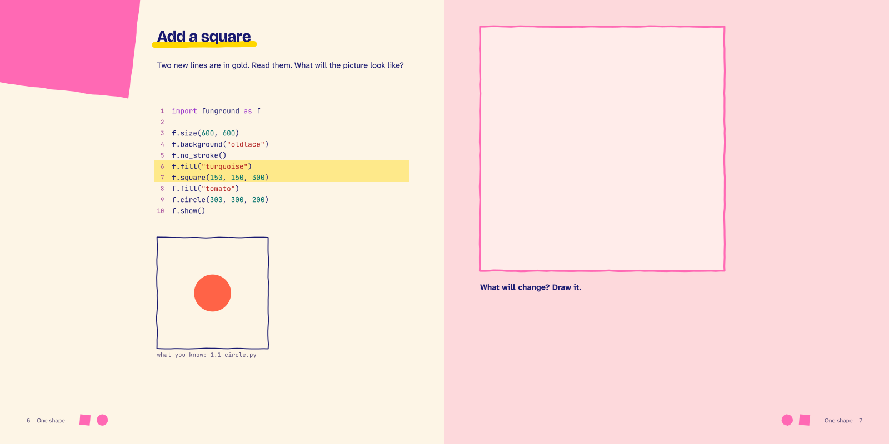
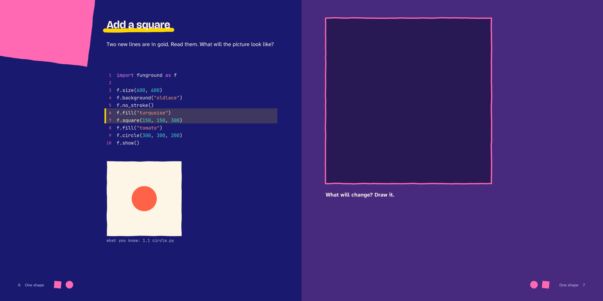

---
hide:
  - navigation
---

<nav class="fg-walk fg-walk--crumb" aria-label="Breadcrumb" markdown>

[A funground book](README.md) › Spread 3 of 6

</nav>

<nav class="fg-walk fg-walk--steps" aria-label="Previous and next spread" markdown>

[‹ Previous: 1.1 One circle](spread_2.md){ rel=prev } [Next: 1.2 Add a square: reveal ›](spread_4.md){ rel=next }

</nav>

# 1.2 Add a square: predict

Predict: two new lines in gold. The right page is an empty frame: draw what you think the picture will be, then turn the page.

**Night**, for reading on a screen:

<nav class="fg-walk fg-walk--steps" aria-label="Previous and next spread" markdown>

[‹ Previous: 1.1 One circle](spread_2.md){ rel=prev } [All spreads](README.md) [Next: 1.2 Add a square: reveal ›](spread_4.md){ rel=next }

</nav>
