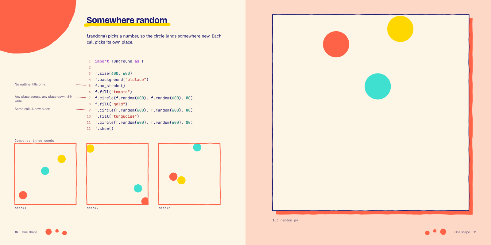
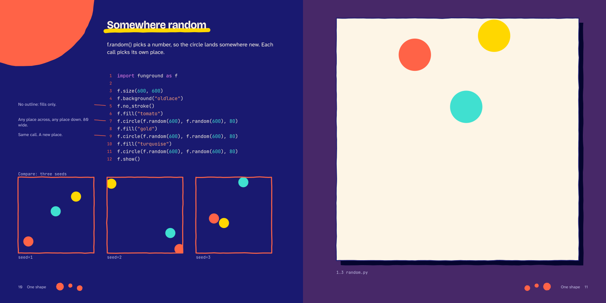

---
hide:
  - navigation
---

<nav class="fg-walk fg-walk--crumb" aria-label="Breadcrumb" markdown>

[A funground book](README.md) › Spread 5 of 6

</nav>

<nav class="fg-walk fg-walk--steps" aria-label="Previous and next spread" markdown>

[‹ Previous: 1.2 Add a square: reveal](spread_4.md){ rel=prev } [Next: 1.4 Your page ›](spread_6.md){ rel=next }

</nav>

# 1.3 Somewhere random

Show: the same circle at a random place, drawn many times.

**Night**, for reading on a screen:

<nav class="fg-walk fg-walk--steps" aria-label="Previous and next spread" markdown>

[‹ Previous: 1.2 Add a square: reveal](spread_4.md){ rel=prev } [All spreads](README.md) [Next: 1.4 Your page ›](spread_6.md){ rel=next }

</nav>
