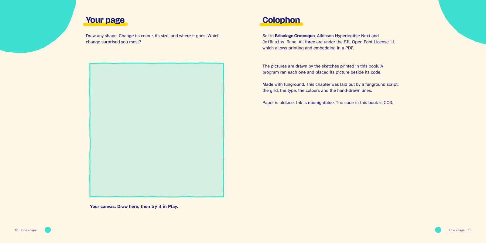
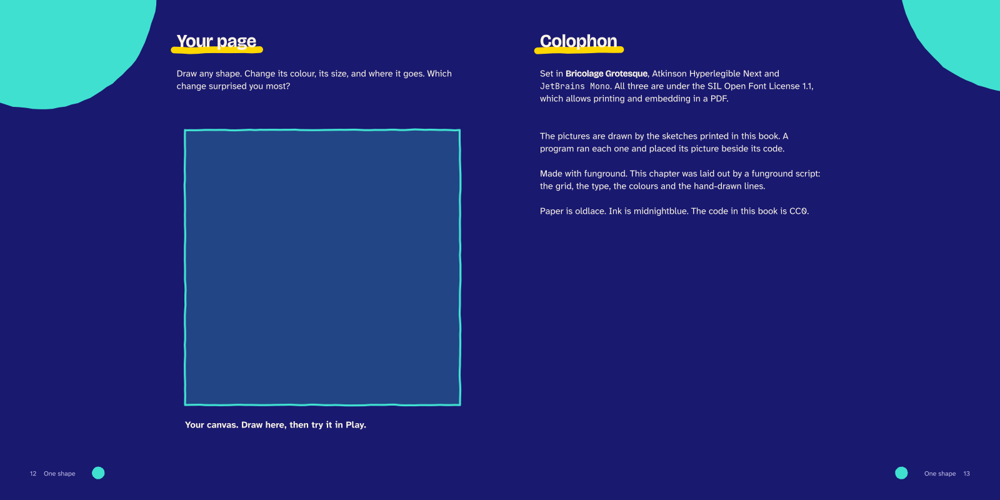

---
hide:
  - navigation
---

<nav class="fg-walk fg-walk--crumb" aria-label="Breadcrumb" markdown>

[A funground book](README.md) › Spread 6 of 6

</nav>

<nav class="fg-walk fg-walk--steps" aria-label="Previous and next spread" markdown>

[‹ Previous: 1.3 Somewhere random](spread_5.md){ rel=prev }

</nav>

# 1.4 Your page

An empty canvas and a prompt, and the colophon: how the book was made.

**Night**, for reading on a screen:

<nav class="fg-walk fg-walk--steps" aria-label="Previous and next spread" markdown>

[‹ Previous: 1.3 Somewhere random](spread_5.md){ rel=prev } [All spreads](README.md)

</nav>
