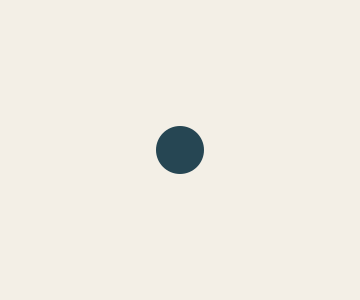
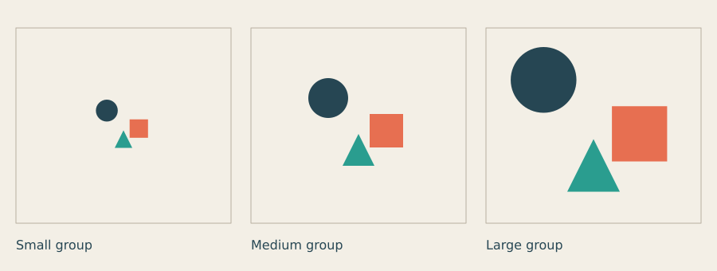
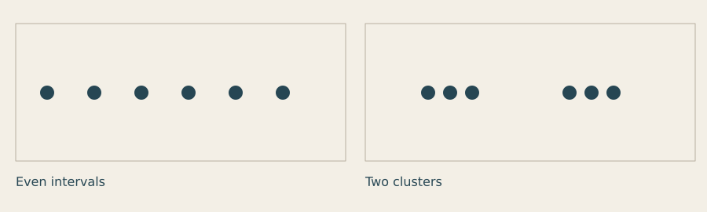
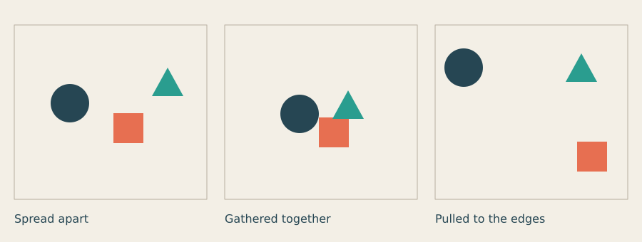

# Lesson 1 — Look, frame and compose

[← Overview](README.md) · [Course index](README.md#the-lessons) · [Lesson 2 →](02_weight_balance_hierarchy.md)

**Question:** How does the space around a mark change what we see?

**Allow:** about 60–90 minutes, plus time to develop your assignment.

By the end, you will be able to describe the relationship between a mark and its frame,
make controlled comparisons, and arrange three shapes to suggest a feeling of your choice.
You will use coordinates, simple shapes and PNG saving. No loop is needed for your first piece.

## 1. Start by looking

Choose an object near you: a book cover, a sign, a leaf on a table or a picture on your phone.
Look for thirty seconds without deciding whether it is good or bad.

Write three sentences beginning **“I notice…”** For example:

- “I notice the title is close to the upper edge.”
- “I notice one small red patch in a mostly pale image.”
- “I notice more empty space below the object than above it.”

Now add one sentence beginning **“This makes me expect…”** The first sentences describe
visible choices; the last sentence interprets them. Keeping those apart helps you give useful
feedback. Someone can agree with your observation and read its effect differently.

## 2. The frame changes the mark

A **composition** is the arrangement of what is inside a frame. A **mark** is something you
draw: a dot, line, shape, letter or image. The **frame** is the boundary that gives the marks
a place to relate to: a page, screen, poster or window.

A circle by itself has a size and colour. Put it near a corner and we also notice its distance
from two edges. Put it low in a frame and the large space above it becomes part of the picture.

**Negative space** is the space around and between marks. It is not leftover space that must
be filled. It can separate things, connect them, give them room or make their position feel
deliberate. You will test this before adding detail.

## 3. Make one circle together

Download [the starter sketch](../../examples/course/01_starter.py), or copy this complete
program into a new file named **01_starter.py**.

```python
import funground as f

X = 180
Y = 150
DIAMETER = 48

f.size(360, 300)
f.background("#f3efe6")
f.no_stroke()
f.fill("#264653")
f.circle(X, Y, DIAMETER)
f.save("01_starter.png")
f.show()
```

Run it in the Python environment you used for your first working Funground sketch:

```sh
python 01_starter.py
```



Here is what each part does:

| Code | What you see |
|---|---|
| **f.size(360, 300)** | A frame 360 units wide and 300 high. |
| **f.background(...)** | The paper colour fills the frame. |
| **f.no_stroke()** | Shapes have no outline. |
| **f.fill(...)** | The next shape uses this colour. |
| **f.circle(X, Y, DIAMETER)** | A circle centred at X, Y; its size is its diameter. |
| **f.save(...)** | A PNG is saved in the folder from which you ran the program. |
| **f.show()** | The image opens in a Funground window. Close it to finish. |

For this script, coordinates begin at the top-left: x increases to the right and y increases
downwards. The frame's centre is (180, 150).

The circle's **diameter** is its full width, not its radius. This circle extends 24 units
to each side of its centre.

## 4. Experiment A: change position, keep the mark

Before changing the code, predict: what will happen if the circle sits close to two edges?

1. Change X to **35** and Y to **35**.
2. Change the saved filename to **01_corner.png**.
3. Run the sketch again.
4. Keep the original and new images. What changed besides the coordinates?

Then try X = **180**, Y = **250**. Save it as **01_low.png**.

Here is a comparison using the same idea on one sheet:


[Run the complete comparison sketch](../../examples/course/01_positions.py).

Notice the gap between the circle and each edge. In the left panel, two small gaps can make
the circle seem tucked away or pressed toward a corner. The middle panel distributes space
more evenly. In the right panel, the large space above the circle may become more noticeable.

These are possible readings, not fixed meanings. Write what you actually notice.

**One more test:** move the low circle five units at a time toward the bottom. When does the
gap begin to look accidental, cramped or deliberate to you? There is no magic margin that
works for every mark.

<details>
<summary>If part of the circle disappears</summary>

A shape can extend beyond the frame and be cropped. With a diameter of 48, a centre at x = 10
puts 14 units of the circle outside the left edge. Try x = 24 to make the circle just touch
the edge, then x = 35 to give it a small gap. Cropping can be intentional; first learn to
recognise when it happens.

</details>

## 5. Experiment B: give the group more room

A composition can change even when its internal relationships stay the same. Compare these
three versions: the group grows, while its proportions, colours and frame remain fixed.



[Run the scale comparison](../../examples/course/01_space.py).

Look at the empty area outside the group. In which panel do you notice the frame first?
Where do the marks begin to occupy most of your attention? Does the large version feel
more confident, more crowded or simply easier to read?

Try this with your one-circle sketch first. Set DIAMETER to **24**, **48** and **120**.
Keep X and Y fixed. Save each version.

Then add one square after the circle and before saving:

```py
f.fill("#e76f51")
f.rect(230, 170, 42, 42)
```

This is a fragment to insert into your working sketch. A rectangle uses its **top-left**
corner, while a circle uses its **centre**. The rectangle therefore begins at (230, 170);
it is not centred there.

Move the square without moving the circle. Compare a small gap, a large gap and an overlap.
What kind of relationship does each arrangement suggest?

## 6. Experiment C: space makes groups

Things close together often look as if they belong together. Compare these two rows:



[Run the grouping comparison](../../examples/course/01_grouping.py).

Both panels contain six circles of the same size and colour. The larger middle gap in the
right panel makes two groups easier to read. The space does the grouping work; nothing
has been added around the circles.

**Try on paper first:** draw six dots. Make them look like three pairs using spacing alone.
Then try one group of four and one group of two. If the groups are difficult to see, increase
the difference between the small and large gaps.

For your coded experiment, change the x positions in the second list of the downloaded
comparison sketch. Keep the dot size fixed. Lists and loops are explained by the Python code;
you can also draw six individual circles if that is easier.

## 7. Make your own: three marks, three readings

Download [the assignment starter](../../examples/course/01_exercise.py). It gives you a
circle, square and triangle. Choose one word to explore: **quiet**, **crowded**, **unstable**
or **open**. You can choose a different word if these do not interest you.

1. Make six tiny arrangements on paper. Spend no more than a minute on each.
2. Choose three arrangements that explore different relationships to the frame.
3. Change only the positions in the starter. Keep sizes and colours fixed.
4. Set VERSION to **a**, **b** and **c** as you save each version.
5. Compare the outputs and choose one to develop.

Here are three possible arrangements, using identical marks:



[Run these examples](../../examples/course/01_composition.py). They demonstrate different
spacing choices; they are not answers to your assignment. Your arrangements can look very
different.

<details>
<summary>A hint if all your versions look alike</summary>

Make one version in which the marks almost touch. Make another in which the gap between
them is larger than any mark. For the third, change how close the group is to an edge.
These are deliberate experiments, even if you do not keep the results.

</details>

**Optional extension:** after completing the three position studies, change the frame from
landscape to portrait. Which relationships survive? Rearrange the same marks to fit the
new frame rather than simply shrinking the whole composition.

## 8. Review, then keep

Ask a viewer to look at your three versions without telling them your chosen word.

- What do they notice first?
- Which two marks seem connected?
- Which version suggests the feeling you intended?
- What visible choice led to that reading?

You are ready to continue when you can point to a gap, edge relationship or grouping choice
and describe what it changes. You do not need everyone to interpret it identically.

Keep the three images, the code for your chosen version and this short note:

> I wanted to suggest ____. I changed ____. I noticed ____. I kept version ____ because ____.

## Reference and further looking

- [Your first sketch](../guide/02_the_sketch.md): scripts and animated sketches.
- [Shapes](../guide/03_shapes.md): coordinate placement and shape arguments.
- [Saving your work](../guide/13_saving_your_work.md): PNG, PDF and SVG output.
- [Quick Reference](../reference/Quick_Reference.md) and [API reference](../reference/API.md):
  look up a function when you need its exact arguments.

Before the next lesson, collect three examples of interesting empty space from daily life:
a sign, a page, a window display or an object on a surface. Write a sentence about the space
in each. The epilogue contains optional books, video and follow-up exercises.

---

[← Overview](README.md) · [Course index](README.md#the-lessons) · [Lesson 2 →](02_weight_balance_hierarchy.md)
