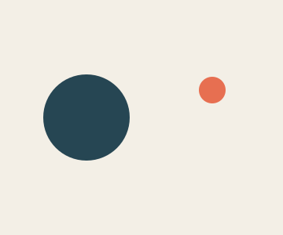
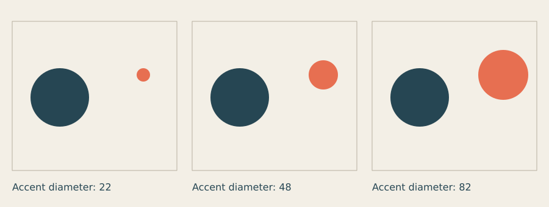
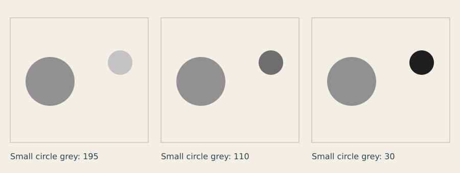
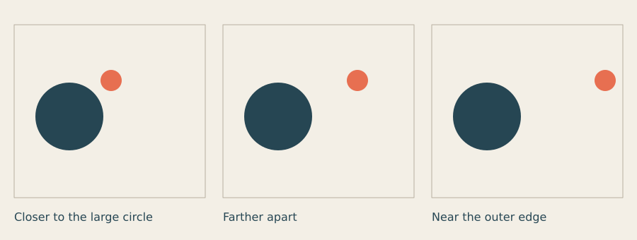
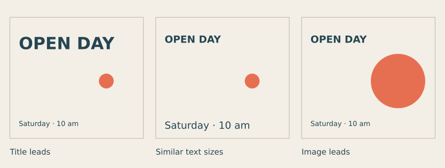

# Lesson 2 — Visual weight, balance and hierarchy

[← Lesson 1](01_look_frame_compose.md) · [Course index](README.md#the-lessons) · [Lesson 3 →](03_contrast_colour.md)

**Question:** What attracts attention, and how do unlike elements balance?

**Allow:** about 60–90 minutes, plus time to develop your notice card.

You will compare size, lightness and spacing; explain which element attracts attention;
and give a short message a deliberate reading order. Keep your Lesson 1 studies nearby.
They already contain evidence about how placement and empty space affect a picture.

## 1. Look for the first thing you see

Find a notice, book cover or public sign with both words and an image. Look for two seconds,
then look away. What do you remember? Look again and name three visible choices that might
explain it: a large title, a bright colour, a dark patch, an isolated shape or a familiar image.

There may be several reasons. In this lesson you will isolate some of them so you can see
which change helped, rather than changing everything at once.

## 2. Three connected ideas

**Visual weight** describes how strongly an element seems to pull attention or occupy the
composition. Size can contribute, but so can contrast, colour, detail, isolation and meaning.
A small word that matters to a viewer may attract more attention than a large decorative shape.

**Balance** describes the distribution of those visual weights. Symmetry is one way to organise
them. Unequal elements can also feel balanced. Sometimes a designer chooses tension or an
uneven composition because that suits the message.

**Hierarchy** is the order of attention. A notice might lead with the event name, then the
date, then the place. If every element asks for equal attention, the viewer must work harder
to find that order.

These are tools for describing and making choices. There is no universal equation that
calculates the best balance or guarantees where every person will look.

## 3. Make two unequal marks

Download [the two-circle starter](../../examples/course/02_starter.py) or copy this program:

```python
import funground as f

LARGE_X, LARGE_Y, LARGE_SIZE = 110, 150, 110
SMALL_X, SMALL_Y, SMALL_SIZE = 270, 115, 34

f.size(360, 300)
f.background("#f3efe6")
f.no_stroke()
f.fill("#264653")
f.circle(LARGE_X, LARGE_Y, LARGE_SIZE)
f.fill("#e76f51")
f.circle(SMALL_X, SMALL_Y, SMALL_SIZE)
f.save("02_starter.png")
f.show()
```



Which circle do you notice first? The large circle occupies more space; the smaller one has
a contrasting colour and is separated from it. Notice the whole arrangement before deciding
which property matters most.

The variables group the decisions you can change. The drawing calls apply those decisions.
The code does not choose the balance for you.

## 4. Experiment A: vary one size

Predict what happens if the small circle grows while everything else stays fixed.

1. Set SMALL_SIZE to **22** and save **02_small.png**.
2. Set it to **48** and save **02_medium.png**.
3. Set it to **82** and save **02_large.png**.
4. Compare the three images. Keep the large circle, positions and colours unchanged.



[Run the size comparison](../../examples/course/02_size.py).

Which version gives the orange circle a supporting role? Where does it become a competing
focus? You might prefer either outcome depending on your intention.

**Try another prediction:** if both circles become the same colour, will size become easier
to judge? Make that version before reading on.

<details>
<summary>If you cannot tell what the size change did</summary>

Use a larger difference, such as diameters 12 and 90. Compare the extremes first, then test
a value between them. Small changes are easier to judge after seeing the range.

</details>

## 5. Experiment B: change value, keep size

**Value** is how light or dark a colour appears. It affects contrast with the background.
For this experiment, remove the colour difference and use greys.

In the starter, replace the fill before the large circle with **f.fill(145)**.
Replace the fill before the small circle with **f.fill(195)**.
A single number chooses a grey: 0 is black and 255 is white in the default colour mode.

Keep SMALL_SIZE at **48**. Change only its grey to **195**, **110** and **30**.



[Run the value comparison](../../examples/course/02_value.py).

The small dark circle has more contrast with the pale background than the small light circle.
Does that change the balance or reading order for you? It may not outweigh the large circle,
but it can become more noticeable.

**Transfer the idea:** find a heading on a page you made. Would changing its value help more
than increasing its size? Try both separately. Lesson 3 will explore colour more fully.

## 6. Experiment C: change the relationship

Return to the original two colours and set SMALL_SIZE to **30**. Move the small circle
horizontally while keeping its y position fixed.



[Run the distance comparison](../../examples/course/02_distance.py).

Look at both gaps: between the circles and between the small circle and the edge. A close
pair may read as one group; a separated small mark may become a distinct point of attention.
Near an edge it can create tension, appear isolated or seem squeezed into leftover space.

**Try three positions yourself:**

- close enough to make a pair;
- far enough away to feel independent;
- near an edge, but with a deliberate gap.

Describe each relationship before choosing one. Avoid calling a position balanced solely
because the two objects are equally distant from the centre.

## 7. Turn attention into a reading order

Now put a message into the frame. Imagine an open day with two essential pieces of text:
**OPEN DAY** and **Saturday · 10 am**.

Start with an intended order: title first, date second. Add one visual mark that supports
the card without confusing that order.

Download [the notice-card starter](../../examples/course/02_exercise.py). Here is its
complete code:

```python
import funground as f

# Edit one variable at a time, then save another version.
HEADING_SIZE = 36
DETAIL_SIZE = 16
MARK_SIZE = 50
HEADING_Y = 50
MARK_X, MARK_Y = 270, 170
VERSION = "a"

f.size(360, 300)
f.background("#f3efe6")
f.no_stroke()
f.fill("#e76f51")
f.circle(MARK_X, MARK_Y, MARK_SIZE)
f.fill("#264653")
f.text_align("left", "top")
f.text_style("bold")
f.text_size(HEADING_SIZE)
f.text("OPEN DAY", 30, HEADING_Y)
f.text_style("normal")
f.text_size(DETAIL_SIZE)
f.text("Saturday · 10 am", 30, 250)
f.save("02_exercise_" + VERSION + ".png")
f.show()
```

The new functions are:

| Function | Its job here |
|---|---|
| **f.text_align("left", "top")** | Place the left and top of the text at the given point. |
| **f.text_style("bold")** | Give subsequent text a stronger style. |
| **f.text_size(...)** | Set the size of subsequent text. |
| **f.text(...)** | Draw the words at the given position. |

Style and size stay in effect until changed. The detail therefore explicitly switches back
to normal style and uses its own size. You can use Funground's default font for this lesson;
choosing typefaces comes later.

Compare three different hierarchies:



[Run the hierarchy comparison](../../examples/course/02_hierarchy.py).

The middle panel gives the title and date similar sizes. It does not remove every other cue:
the title still has bold style and sits above the date. The last panel gives the image more
weight. Does it help the message or distract you from it? Decide using your intended order.

## 8. Make your own: a notice with two different priorities

Choose a real or invented event. Keep its title short so you can concentrate on hierarchy.
Make three studies:

1. **Words lead:** the event name should be found first.
2. **Image leads:** the mark should attract attention, then lead toward the words.
3. **Date leads:** make the timing the most prominent information.

Keep the paper size, text content and two colours the same. Change size, position or style
one at a time while developing each study. Save all three.

Then choose one study and adapt it for a different purpose. For example, a community notice
may need the date found quickly; a teaser for an exhibition may lead with an intriguing image.
Write one sentence explaining the change in priority.

<details>
<summary>If the card feels crowded</summary>

Reduce the mark or remove it temporarily. Move the heading and detail farther apart, then
closer together. Restore the mark only when you can describe its role. Filling empty space
is not a sufficient role on its own.

</details>

<details>
<summary>If the words overflow the frame</summary>

Use a shorter title, reduce its size or leave more horizontal room. Do one change at a time.
For a longer title, learn text boxes in the Text guide; you do not need them to finish this
short-heading exercise.

</details>

**Optional extension:** make a thumbnail one quarter of the original width. Ask which
information survives. Revise the card if the first thing noticed is decorative while an
essential detail becomes impossible to read.

## 9. Review with a viewer

Show each study for two seconds, then hide it. Ask:

- What did you notice first?
- What words do you remember?
- What do you think the card asks you to do?

A short glance tests first attention; it does not prove every detail is readable.
Show the card again at its intended size and ask the viewer to find the date.

Compare the answers with your intended order. If the order differs, choose one variable
to change: size, value, position or spacing. Make a revision and test it again.

You are ready to continue when you can explain how one controlled change affected attention
and can give the card a deliberate reading order. An uneven composition can still be a
successful choice if it supports the purpose.

Keep your three studies, one revision and this note:

> The intended first element was ____. The viewer noticed ____. I changed ____.
> The next version worked better / differently because ____.

## Reference and further looking

- [Shapes](../guide/03_shapes.md): placement and size.
- [Colour](../guide/04_colour.md): greys, colour values and fill.
- [Text](../guide/06_text.md): styles, sizes, alignment and text boxes.
- [Saving your work](../guide/13_saving_your_work.md): output formats.
- [Quick Reference](../reference/Quick_Reference.md) and [API reference](../reference/API.md):
  exact calls when you need them.

Before Lesson 3, find one design where size creates the hierarchy and one where contrast
does more of the work. Point to the evidence in each. The epilogue contains optional reading,
video and follow-up exercises.

---

[← Lesson 1](01_look_frame_compose.md) · [Course index](README.md#the-lessons) · [Lesson 3 →](03_contrast_colour.md)
