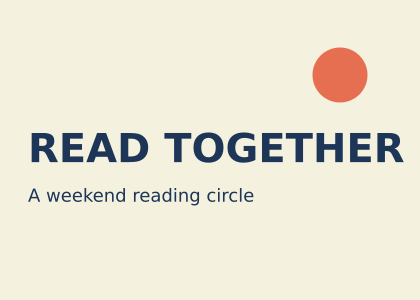
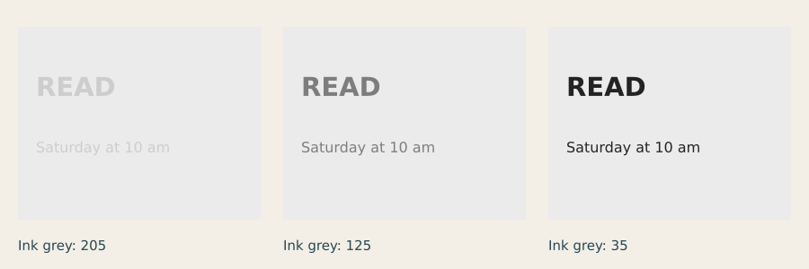
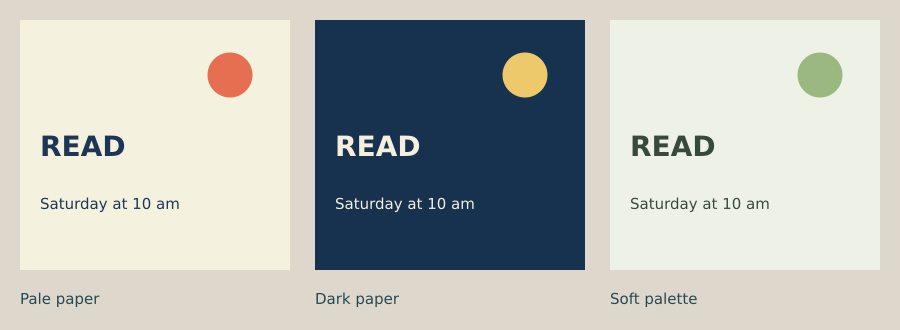

# Lesson 3 — Contrast and colour

[← Lesson 2](02_weight_balance_hierarchy.md) · [Course index](README.md#the-lessons) · [Lesson 4 →](04_shape_figure_ground.md)

**Question:** How can colour support a message and keep it readable?

**Allow:** 60–90 minutes and a further session for your assignment.

You will separate colour roles, compare lightness before changing hue, and develop two
palettes for one message. Keep the card layout fixed so that you can see what colour changes.
You will use named colour variables, greys and hexadecimal colours.

## 1. Look for colour doing a job

Find a package, book cover or sign with only a few colours. Name the colour covering the
largest area, the colour carrying the words, and any small accent. What would become harder
to find if the accent were removed? What would happen if all the words used that accent?

Write an observation before a judgement: “The date is the only orange text” is more useful
than “The colour is good.” A colour decision needs a purpose.

## 2. Separate three decisions

**Hue** is a colour family, such as red, blue or green. **Value** describes lightness or
darkness. **Saturation** describes how intense or muted a colour appears. These dimensions
relate to each other in the finished image; changing a colour can alter several at once.

Different hues do not automatically make readable text. Two colours can be different but
close enough in lightness that small letters are difficult to separate from the background.
Begin by testing value, then choose hues that suit your subject.

For this lesson, give colours three roles:

| Role | Job |
|---|---|
| Paper | Holds the composition and establishes the background. |
| Ink | Carries essential information. |
| Accent | Highlights one chosen element or adds character. |

A limited palette gives you fewer decisions to manage. These roles are a useful starting
constraint, not a rule that every design must follow.

## 3. Make a card together

Download [the starter](../../examples/course/03_starter.py), or copy the complete script.
The fictional reading circle gives the palette a communication task.

```python
import funground as f

PAPER = "#f4f1de"
INK = "#1d3557"
ACCENT = "#e76f51"

f.size(420, 300)
f.background(PAPER)
f.no_stroke()
f.fill(ACCENT)
f.circle(340, 75, 55)
f.fill(INK)
f.text_align("left", "top")
f.text_style("bold")
f.text_size(40)
f.text("READ TOGETHER", 28, 125)
f.text_style("normal")
f.text_size(18)
f.text("A weekend reading circle", 28, 185)
f.save("03_starter.png")
f.show()
```



The three variables at the top let you change colour without searching through the layout.
Each hexadecimal string starts with **#** and describes red, green and blue components.
You can use a named colour such as **"navy"** instead; the
[Colour guide](../guide/04_colour.md) explains the accepted forms.

First run the card unchanged. Note the saved PNG filename. Before another experiment,
change the filename so the first version remains available.

## 4. Experiment A: value before hue

Predict which words will be easiest to find in this comparison.



[Run the value comparison](../../examples/course/03_values.py).

The paper grey is held at 235. The ink changes from 205 to 125 to 35. A single number in
**f.fill(...)** makes a grey in the default colour mode: 0 is black and 255 is white.
Notice the small date as well as the large title. Large bold letters can remain visible
after smaller details become difficult to read.

Try this in your starter:

1. Set PAPER to **235** and INK to **205**. Keep ACCENT unchanged.
2. Run and save a version.
3. Change only INK to **35**, then save another version.
4. Compare at the intended size and as a thumbnail.

This is a visual experiment, not a formal accessibility test. If you are designing an
actual interface or public information, use the applicable accessibility requirements
and contrast-checking tools as part of your final review.

<details>
<summary>If both versions seem readable</summary>

Look at the smaller detail from farther away or reduce the preview. Then try a value even
closer to the paper. The aim is to notice where separation becomes weak, not to prove that
a particular grey is always suitable.

</details>

## 5. Experiment B: give the palette a character

Now compare three palettes applied to one unchanged layout:



[Run the palette comparison](../../examples/course/03_palettes.py).

Each version assigns colours to paper, ink and accent. Describe your reading of each
before labelling it cheerful, serious or gentle. Colour associations depend on subject,
culture and context; there is no universal mood attached to a hex value.

Choose one palette and swap PAPER and INK in the starter. Does the same accent still work?
Next, swap INK and ACCENT. Is the important text still clear, or has the colour meant for
a small highlight become tiring over a large area?

**A useful question:** which colour changed the character most, and which colour mainly
protected readability? Those roles may overlap.

## 6. Guided practice: reduce the palette

Make a two-colour version by setting ACCENT equal to INK. Compare it with the original.

Then restore the third colour and give it one specific job: highlight the title, the date,
or the mark. Avoid assigning it to every element merely because you like it.

Describe the visual order again. Does the accent reinforce the hierarchy you made in
Lesson 2, or create a competing first element?

## 7. Make your own: two audiences, one layout

Choose a short message for a reading club, music evening, walking group or invented event.
Use the starter's layout or your notice card from Lesson 2.

1. Write two different audience or tone intentions, such as “informal invitation” and
   “quiet evening gathering.”
2. Make at least four small palette trials.
3. Keep the words, sizes and positions fixed for these colour studies.
4. Select one palette for each intention and save the two cards.
5. Write down which colours have which jobs.

Show the cards without revealing your intentions. Ask which words are easiest to read and
what sort of event each card seems to promise. Interpret the responses as evidence about
your audience, rather than a verdict that one palette is objectively better.

<details>
<summary>If the palettes look unrelated to the subject</summary>

Look at something from the event itself: books, a venue, instruments or a time of day.
Choose one observed colour as a starting point. Build readable paper and ink around it;
you do not have to reproduce every colour in the reference.

</details>

**Optional extension:** make a monochrome version. Does it retain the intended reading
order? Add labels or shape differences wherever an essential distinction relied only on
colour.

## 8. Review and keep

Keep the value study, your two selected palettes, their code and a short note:

> I used ____ as paper, ____ as ink and ____ as accent. The essential information was ____.
> When I changed ____, the card read as ____.

You are ready to continue when you can explain a colour's role and identify a case where
small text needs stronger separation from the background.

## Reference and further looking

Use [Colour](../guide/04_colour.md), [Text](../guide/06_text.md) and the
[API reference](../reference/API.md) for exact calls. The
[course epilogue](epilogue.md#further-material) lists optional further reading.

For further practice, collect three limited palettes from daily life. Record the *roles*
of their colours, not just the colours themselves.

---

[← Lesson 2](02_weight_balance_hierarchy.md) · [Course index](README.md#the-lessons) · [Lesson 4 →](04_shape_figure_ground.md)
