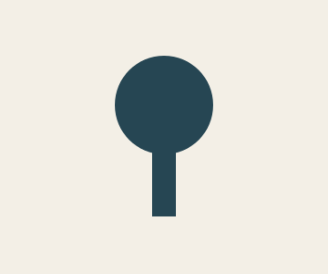
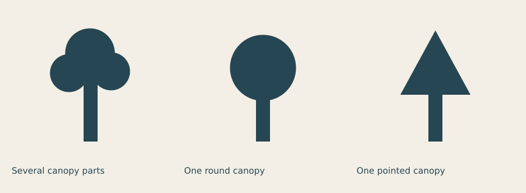
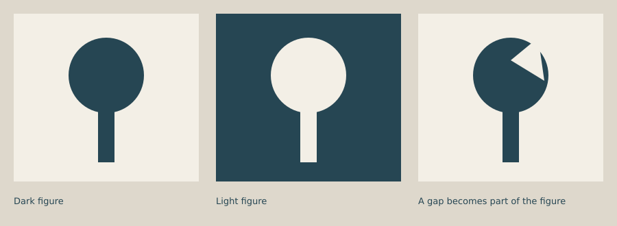
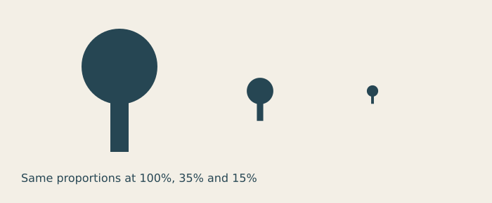

# Lesson 4 — Shape, figure and ground

[← Lesson 3](03_contrast_colour.md) · [Course index](README.md#the-lessons) · [Lesson 5 →](05_rhythm_variation.md)

**Question:** Which features make a shape recognisable?

**Allow:** 60–90 minutes, with extra time for the symbol family.

You will make a silhouette, simplify it, reverse its figure and ground, and check it at
small sizes. Your assignment is a family of three symbols. You will use primitive shapes
and a small set of proportions rather than detailed drawing.

## 1. Look at the outside edge

Choose an everyday object with a recognisable shape: a cup, leaf, shoe or key.
Sketch its outside edge without drawing any internal detail. Now make it much smaller.

Which feature still identifies it? The handle, the long stem, a notch or its overall
proportion may carry more information than a texture or decorative line.

**Abstraction** means choosing what to keep and what to leave out. It is a decision about
meaning. A simpler drawing is useful when the remaining features still do the intended job.

## 2. Figure and ground work together

The **figure** is the element you attend to; the **ground** is the surrounding area.
Their relationship may be obvious or deliberately ambiguous. The spaces inside a letter,
between two limbs or under a handle can be as important as the outer contour.

A **silhouette** shows a filled outline with little internal detail. It is a good test of
whether the form is carrying the idea. A symbol can be recognisable without being realistic,
but you should test that reading with someone unfamiliar with your intention.

## 3. Build a simple tree

Download [the starter](../../examples/course/04_starter.py) or copy it:

```python
import funground as f

PAPER = "#f3efe6"
INK = "#264653"
f.size(360, 300)
f.background(PAPER)
f.no_stroke()
f.fill(INK)
f.rect(167, 155, 26, 82)
f.circle(180, 115, 108)
f.save("04_starter.png")
f.show()
```



The rectangle forms the trunk; the circle forms the canopy. They overlap. Because the two
shapes use the same fill and have no stroke, the overlap reads as one silhouette.

Notice the placement conventions: the rectangle begins at its top-left, while the circle
is centred at its coordinate. Its diameter of 108 gives a radius of 54.

Try two changes separately:

1. Make the trunk 12 units wide, keeping its centre at x = 180.
2. Make the canopy's diameter 150, leaving the trunk unchanged.

What changes in the reading? A thin trunk with a large canopy may suggest a different sort
of tree or an unstable proportion. Describe what the proportion suggests to you.

<details>
<summary>If the trunk shifts when you change its width</summary>

The original trunk begins at x = 167 and is 26 wide: its centre is 180. For a width of 12,
set the left edge to 174. More generally, left edge = centre minus half the width.
Changing the width without moving the left edge shifts the centre too.

</details>

## 4. Experiment A: keep the idea, change the outline

Compare three ways to make a tree:



[Run the reduction comparison](../../examples/course/04_reduction.py).

The first version uses several overlapping parts. The second merges the canopy into one
circle. The third uses a triangle. None is inherently the correct tree. Each keeps a trunk
and an upper mass while changing the contour and associations.

Try simplifying your own object sketch. Remove one part at a time, then ask someone what
it depicts. Where does the reading become uncertain? Restore or alter the feature that
helps most.

**A stronger experiment:** make two versions with the same number of shapes but different
proportions. Complexity alone does not explain recognisability.

## 5. Experiment B: reverse and cut the ground

The same outline can be a dark figure on pale paper or a pale figure on dark paper:



[Run the figure-ground comparison](../../examples/course/04_ground.py).

For the first two panels, the geometry stays fixed and the colours exchange roles.
In the third, a paper-coloured triangle interrupts the canopy. The gap becomes part of
the shape's reading.

In your starter, draw a paper-coloured triangle **after** the canopy and **before** saving:

```py
f.fill(PAPER)
f.triangle(180, 90, 220, 58, 226, 120)
```

This paints a gap for a flat image on that specific background. It does not create a
transparent hole. If you later need a genuine cutout or reusable vector path, the
[Paths guide](../guide/09_paths_and_clipping.md) explains Boolean subtraction.

Change the triangle's position. Does the gap look like damage, a branch opening or a
new abstract feature? Leave it out if it weakens your intended symbol.

## 6. Experiment C: test the small version



[Run the scale test](../../examples/course/04_small.py).

All proportions stay the same, but the small version has less visible detail. At very
small sizes, thin gaps and strokes can disappear. A symbol meant for a sign and one meant
for a tiny button may need different refinements.

Try your drawing at its intended size. Do not assess it only after enlarging the preview.
If a key feature disappears, thicken it, open the gap or reduce competing detail, then
test again.

## 7. Make your own: a family of three symbols

Choose a setting: a library, garden, school club, fictional trail or public event.
Name three things visitors should recognise there.

1. Make six silhouette thumbnails for the first symbol.
2. Select two and test their reading without naming the subject.
3. Choose shared rules for the family: shape vocabulary, proportions, corner character,
   fill or stroke, and amount of detail.
4. Make the other two symbols using those rules.
5. Show all three at both large and intended small sizes.
6. Refine the least clear symbol rather than adding detail everywhere.

A family is more than three unrelated symbols using the same colour. Look for a shared
way of drawing and a similar amount of visual weight.

<details>
<summary>If viewers name the wrong object</summary>

Ask which visible feature suggested that object. Then choose whether to change the contour,
proportion or internal gap. Do not explain the symbol until after collecting the first reading.
A caption can make the final communication clearer, but it should not hide a weak drawing
during this experiment.

</details>

**Optional extension:** make a light-on-dark version of the family. Check small gaps again;
the reversed version may need its own refinement.

## 8. Review and keep

Keep your thumbnails, three symbols, small-size checks and one before/after revision.
Write:

> I kept ____ because it identifies the subject. I removed ____ because it distracted.
> The family shares ____. At small size I changed ____.

Continue when you can identify which feature carries a symbol's reading and show that
the family follows a shared set of choices.

## Reference and further looking

Use [Shapes](../guide/03_shapes.md), [Transforms](../guide/08_transforms.md) and
[Paths, clipping and pictures](../guide/09_paths_and_clipping.md) as needed.
See the [API reference](../reference/API.md) for exact arguments.

For further looking, collect three symbols from a place you visit. Compare their contour,
proportions and internal spaces. The [epilogue](epilogue.md#further-material) contains
reading and follow-up material.

---

[← Lesson 3](03_contrast_colour.md) · [Course index](README.md#the-lessons) · [Lesson 5 →](05_rhythm_variation.md)
