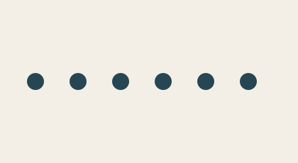
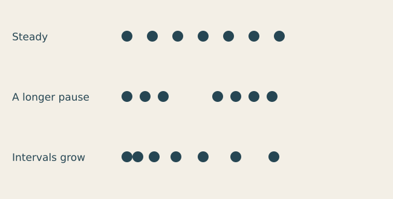
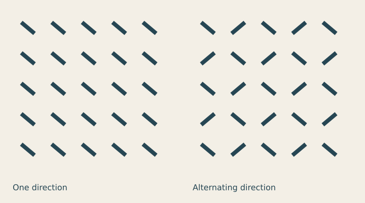

# Lesson 5 — Repetition, rhythm and variation

[← Lesson 4](04_shape_figure_ground.md) · [Course index](README.md#the-lessons) · [Lesson 6 →](06_type_hierarchy.md)

**Question:** How can a repeated mark feel steady, lively or interrupted?

**Allow:** 60–90 minutes, plus time to develop a pattern.

You will use a loop to repeat a mark, vary the intervals and turn one mark into a surface
pattern. The drawing task introduces loops because consistent repetition is useful here.

## 1. Notice a beat

Look at a fence, staircase, row of windows or fabric. What repeats? What changes?
Tap the pattern with a finger: does it have equal beats, a pause, a cluster or an accent?

Repetition establishes an expectation. A change becomes noticeable partly because the
viewer has learned what normally happens. **Rhythm** is the sense of pace created by that
repeat and its variation. It can come from position, size, direction or lightness.

## 2. Make one rule visible

Download [the starter](../../examples/course/05_starter.py):

```python
import funground as f

COUNT = 6
GAP = 60
DIAMETER = 24

f.size(420, 230)
f.background("#f3efe6")
f.no_stroke()
f.fill("#264653")
for index in range(COUNT):
    x = 50 + index * GAP
    f.circle(x, 115, DIAMETER)
f.save("05_starter.png")
f.show()
```



The loop draws six circles. **range(COUNT)** supplies indices 0 through 5.
On each pass, **50 + index * GAP** calculates the next centre: 50, 110, 170 and so on.
Here GAP is the distance between centres, not the empty space between the circles.

Try these changes separately:

1. Change COUNT to 4. Keep the other settings fixed.
2. Restore COUNT to 6 and change GAP to 40.
3. Restore GAP to 60 and change DIAMETER to 44.

Which change affected the empty intervals? Both gap and diameter can do that, but in
different ways. A centre-distance of 40 with a diameter of 44 makes neighbouring circles
overlap.

<details>
<summary>If marks disappear beyond the frame</summary>

Calculate the last centre: 50 + (COUNT - 1) * GAP. Add half the diameter to find the right
edge. If that is wider than the canvas, reduce the count or interval, or deliberately
change the frame. Do not shrink everything until the reason for cropping is clear.

</details>

## 3. Experiment A: make a pause



[Run the rhythm comparison](../../examples/course/05_rhythms.py).

The mark and its diameter stay fixed. One interval rule makes a steady row; another
introduces a gap that reads as a pause; the third increases the intervals.
In the comparison code, the list stores interval values and the loop adds each to x.

Replace the equal intervals with your own list. Begin with six values. Make one of them
larger and keep the rest the same. Predict where a group will appear before running it.

Then make a row that seems to accelerate. Should intervals shrink or grow for the reading
you intend? Test both: a static image can suggest movement, but its reading depends on
where the viewer begins and the direction they follow.

## 4. Guided practice: create an accent

Return to the starter. Keep size and spacing fixed, but change the colour of one mark:

```py
for index in range(COUNT):
    x = 50 + index * GAP
    f.fill("#e76f51" if index == 2 else "#264653")
    f.circle(x, 115, DIAMETER)
```

Replace the original loop with this fragment. The condition selects the third circle,
because counting starts at zero.

Move the accent to the first, last and middle positions. How does the accent change
where you start looking? Keep the colour change alone until you can describe its effect.
You can later combine it with a size or spacing change deliberately.

## 5. Experiment B: repeat a rule in two dimensions



[Run the pattern comparison](../../examples/course/05_patterns.py).

The two loops place rows and columns. The mark is the same small rectangle in both
panels. The second panel alternates its direction. That one rule changes the pattern's
reading without introducing another shape.

Inside **with f.saved_state()**, the code moves the local origin to a cell, rotates the
mark and draws it. When the block ends, the transform and style return to their previous
state. This keeps one mark's rotation from affecting the next.

You can study the loops after drawing the first row manually. The code automates placement;
the choice of mark, spacing and variation is still yours.

## 6. Make your own: one mark, three rhythms

Choose a simple mark from Lesson 4 or invent a new one. Make three small studies:

- a steady rhythm;
- a gradual change;
- a deliberate interruption.

Keep one thing fixed across all three so you can compare them. Select one study and
develop it into a border, textile swatch or small piece of album artwork.

Before adding randomness, write its rule in a sentence. For example: “Every fourth mark
turns sideways,” or “Intervals become smaller toward the right.” If you cannot describe
the rule, reduce the number of variables.

<details>
<summary>If the pattern feels busy</summary>

Remove a colour, reduce the number of directions or increase the space between marks.
Try one change. A stronger mark often needs less repetition than a quieter mark.

</details>

**Optional extension:** repeat the pattern as adjacent tiles. Check whether the boundary
creates an unintended seam or a new beat. Refine the edge rule as part of the design.

## 7. Review and keep

Keep the three studies and your developed pattern. Ask a viewer where the repetition
starts, what changes and where the eye pauses. Write:

> The stable rule is ____. The variable is ____. The pause or accent occurs at ____.
> I changed ____ because ____.

Continue when you can describe a repeat rule and use a loop to alter it deliberately.

## Reference and further looking

Use [Shapes](../guide/03_shapes.md), [Transforms](../guide/08_transforms.md) and
[Useful maths](../guide/12_useful_maths.md). The [API reference](../reference/API.md)
lists exact calls.

For a wider application of repeated rules, watch the
[trigonometry section of the supplied p5.js video](https://www.youtube.com/watch?v=o5t7PxRJSXk&t=1697s).
Watch for the rule and its visual effect; invent a different mark and subject for your own work.

---

[← Lesson 4](04_shape_figure_ground.md) · [Course index](README.md#the-lessons) · [Lesson 6 →](06_type_hierarchy.md)
