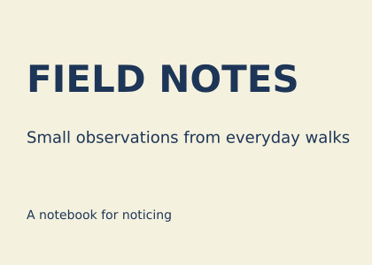
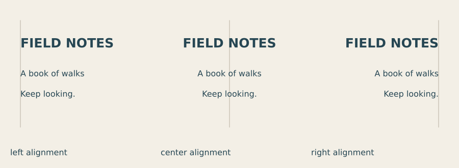
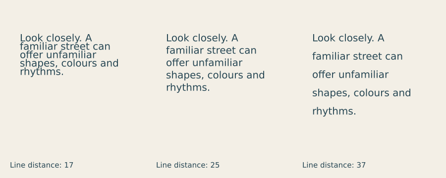

# Lesson 6 — Type, words and hierarchy

[← Lesson 5](05_rhythm_variation.md) · [Course index](README.md#the-lessons) · [Lesson 7 →](07_cover.md)

**Question:** How can words acquire a clear order and voice?

**Allow:** 60–90 minutes and time to revise two title cards.

You will work with alignment, size, style and line spacing. You will keep the built-in
font for the core experiments so that you can concentrate on arrangement before choosing
additional typefaces.

## 1. Read before decorating

Choose a page with a heading and a paragraph. Read it briefly, then describe the order
in which you found the information. Which edges line up? Which spaces separate sections?
Where did you have to work to find the next line?

Typography makes language visible. Its character can suggest a voice, but readers also
need to recognise the words and find their order. **Legibility** concerns recognising
characters; **readability** concerns reading the text in context. Size alone does not
solve either problem.

## 2. Make a title card

Download [the starter](../../examples/course/06_starter.py):

```python
import funground as f

MARGIN = 30
TITLE_SIZE = 42
DETAIL_SIZE = 18

f.size(420, 300)
f.background("#f4f1de")
f.fill("#1d3557")
f.text_align("left", "top")
f.text_style("bold")
f.text_size(TITLE_SIZE)
f.text("FIELD NOTES", MARGIN, 65)
f.text_style("normal")
f.text_size(DETAIL_SIZE)
f.text("Small observations from everyday walks", MARGIN, 145)
f.text_size(14)
f.text("A notebook for noticing", MARGIN, 235)
f.save("06_starter.png")
f.show()
```



The three text blocks share a left edge. Their sizes and vertical gaps distinguish the
title, description and supporting line. The built-in font and its normal and bold styles
are enough to test that hierarchy.

Change TITLE_SIZE from 42 to 24. Do not move the text yet. What changes in the order?
Restore the title and move the description closer. Does it become more clearly connected
to the heading, or too crowded?

## 3. Experiment A: alignment is a relationship



[Run the alignment comparison](../../examples/course/06_alignment.py).

The fine line marks the anchor, not a border for the text. With left alignment, x places
the left edge. With centre alignment, x places the centre. With right alignment, x places
the right edge.

To centre the starter, change the alignment to **f.text_align("center", "top")** and
use x = **210** for every text block. Change the coordinates as well as the alignment:
centred text at x = 30 would extend outside the left side of the frame.

Compare all three versions. Which fits your message? Centred text can suggest a formal
announcement; a common left edge can help the eye return to the start of several lines.
These are possibilities to test, not compulsory meanings.

<details>
<summary>If the card seems misaligned despite equal x values</summary>

Check whether one text block still uses a different alignment from an earlier call.
Drawing state persists until changed. Also notice that the visible shapes of different
letters can make an edge feel slightly uneven. First establish consistent coordinates;
refine by eye only when there is a visible reason.

</details>

## 4. Experiment B: give lines enough room

A paragraph is not just a set of independent labels. Readers need to find the start of
the next line. **Leading** is the distance from one line to the next.



[Run the spacing comparison](../../examples/course/06_spacing.py).

The type size and text-box width remain fixed. Only line distance changes. Tight lines
may collide visually; very loose lines may stop feeling like one paragraph. Choose in
relation to the font, size, line length and reading situation.

To try a paragraph below your title, replace the existing description with this fragment:

```py
f.text_style("normal")
f.text_size(18)
f.text_leading(25)
remaining = f.text_box(
    "Look closely. A familiar street can offer unfamiliar shapes and rhythms.",
    30, 145, 340, 100
)
print("Text that did not fit:", remaining)
```

**f.text_box(...)** wraps words within the width and height. Its return value is any text
that did not fit. Do not ignore that result in a final layout: a visually neat box can
still have lost part of the message.

If the paragraph meets the footer, move the footer, shorten the text or change the space
available. Avoid simply shrinking the type until it becomes hard to read.

## 5. Guided practice: keep one family, vary its roles

Using the same font, make three combinations:

1. large bold heading, smaller normal detail;
2. equal sizes, but bold heading and normal detail;
3. smaller heading, larger detail.

Keep the words and alignment fixed. Describe which cues establish the hierarchy in each.
The second combination shows that size is only one cue; style and position still matter.

Try italic for a short supporting line if it suits the voice. Avoid changing every block
to a different style. A small number of choices becomes easier to keep consistent across
a series.

## 6. Make your own: two voices for the same words

Choose a short title and a two-sentence description. Make two title cards for different
contexts: for example, an informal walking notebook and a formal exhibition announcement.

1. Write the intended audience and reading order for each.
2. Make four paper thumbnails before refining the code.
3. Develop two cards using size, style, alignment and spacing.
4. Check them close up, at intended size and as thumbnails.
5. Ask someone to read each aloud in the order they notice the words.

Use the default font first. If you later load another font, check its licence and recheck
fit: a new font can change word widths and line breaks. The Text guide explains how to
load a font and why a loaded font needs its own bold file when you want a bold style.

<details>
<summary>If every line asks for attention</summary>

Choose one first element. Reduce a supporting element's size or weight, or give the first
element more surrounding space. Make one change and compare the reading order again.

</details>

**Optional extension:** use a title in a language you read comfortably. Check the actual
letter shaping and line breaks in the exported file, rather than assuming every script
fits the same spacing decisions.

## 7. Review and keep

Keep both cards, one spacing experiment and an early thumbnail. Write:

> The intended order is ____. Alignment connects ____. I gave ____ more space because ____.
> The text box returned ____.

Continue when you can explain the hierarchy and show that the complete text fits at a
usable reading size.

## Reference and further looking

Use [Text](../guide/06_text.md), [Saving your work](../guide/13_saving_your_work.md) and
the [API reference](../reference/API.md).

For further looking, compare a newspaper heading, a book page and an event invitation.
Describe their type hierarchy and spacing before comparing typefaces.
[Foundations of Digital Art and Design](https://learning.oreilly.com/library/view/foundations-of-digital/9780135711965/)
is an optional broader design reference.

---

[← Lesson 5](05_rhythm_variation.md) · [Course index](README.md#the-lessons) · [Lesson 7 →](07_cover.md)
