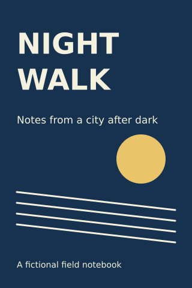
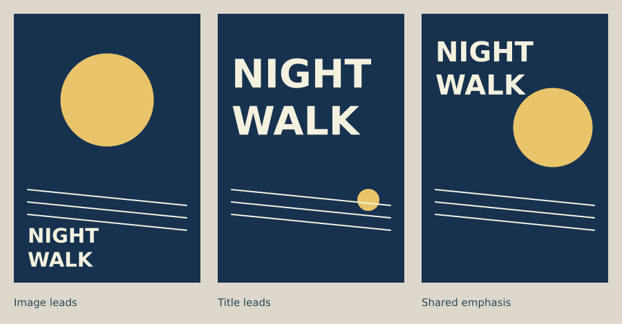

# Lesson 7 — Make a cover

[← Lesson 6](06_type_hierarchy.md) · [Course index](README.md#the-lessons) · [Lesson 8 →](08_poster_systems.md)

**Question:** What should a cover promise its intended reader?

**Allow:** two sessions: one for directions, one for refinement.

You will write a brief, make thumbnails, develop two directions and check the cover at
small size. This combines composition, colour, symbol-making and typography. The code
supports those decisions; begin by deciding what the work is about.

## 1. Read a cover as a promise

Choose a cover for a book, album or zine. Without opening it, write what you expect:
subject, tone and likely audience. Point to the visible choices behind those expectations.

A cover identifies a work and gives a reader a reason to approach it. Its image may explain
the subject, suggest its atmosphere or create a question. Its title must still be found
under the conditions in which people will encounter it.

A beautiful image can make the wrong promise. An energetic cover for a quiet field guide,
for example, might attract a different reader than the author intends.

## 2. Begin with a small brief

Use this fictional example:

> A notebook called Night Walk, for people who enjoy noticing ordinary city streets after
> dark. The cover should suggest quiet observation. The title must remain readable in a
> small catalogue thumbnail.

Write your own brief in four lines: **subject / audience / desired expectation / format**.
Include the exact title and supporting text. You can use an invented work; do not invent
unnecessary marketing copy just to fill space.

## 3. Build one direction together

Download [the starter](../../examples/course/07_starter.py):

```python
import funground as f

PAPER = "#16324f"
INK = "#f4f1de"
ACCENT = "#e9c46a"
MARGIN = 28

f.size(320, 480)
f.background(PAPER)
f.no_stroke()
f.fill(ACCENT)
f.circle(235, 265, 82)
f.stroke(INK)
f.stroke_width(3)
for row in range(4):
    f.line(MARGIN, 320 + row*18, 292, 350 + row*18)
f.no_stroke()
f.fill(INK)
f.text_align("left", "top")
f.text_style("bold")
f.text_size(48)
f.text("NIGHT", MARGIN, 45)
f.text("WALK", MARGIN, 105)
f.text_style("normal")
f.text_size(17)
f.text("Notes from a city after dark", MARGIN, 190)
f.text_size(14)
f.text("A fictional field notebook", MARGIN, 433)
f.save("07_starter.png")
f.save("07_starter.pdf")
f.show()
```



The moon-like circle and slanting lines are abstract cues, not a literal city illustration.
The title uses two lines to fit the portrait frame. The subtitle explains the subject.

Read the code in layers: paper, image marks, title, subtitle, supporting line.
The lines use a stroke; the circles and words use fill. **f.no_stroke()** after the lines
prevents that stroke setting from carrying into subsequent filled shapes.

Run it once and inspect both saved files. The PNG is a fixed-resolution image; the PDF
keeps these drawn shapes and text sharp when enlarged. Neither export automatically adds
a printer's required bleed or colour-production settings.

## 4. Experiment A: image and title as partners



[Run the direction comparison](../../examples/course/07_directions.py).

These are alternative design directions, so several choices change together. They are
not a controlled test of one variable. Use them to choose a direction, then isolate
individual changes while refining it.

Try these relationships in paper thumbnails:

1. **Image leads:** make the image the first invitation and give the title a clear place.
2. **Title leads:** let the words form the strongest image.
3. **Shared emphasis:** connect title and image through placement or a shared shape.

Make at least two thumbnails for each relationship. Keep them small enough that you cannot
spend all your time polishing details.

## 5. Guided practice: refine one direction

Choose a thumbnail and alter the starter:

- Move the title before changing its font or style.
- Move or resize the image so its relationship to the words becomes clearer.
- Check whether subtitle and supporting line still have enough room.
- Remove a decorative element and compare the simpler version.

If a title feels cramped, try a new line break or image placement before making the words
very small. If the image appears unrelated to the title, write down the connection you
intend and test whether a viewer sees it.

<details>
<summary>If the cover looks good large but weak as a thumbnail</summary>

Make the title easier to find or simplify the image. Small marks and narrow gaps may
disappear. Judge at the size a viewer will actually see; enlarging the file hides this
problem rather than solving it.

</details>

## 6. Experiment B: audience changes choices

Keep the subject and title but rewrite the audience: perhaps a quiet personal notebook
becomes a guide for a lively group walk. Which choices now need to change?

Make a second direction. Change the palette, pace of the marks or typographic emphasis
only when you can connect the decision to the brief. Different does not automatically
mean better: each cover should make its own appropriate promise.

Show both without revealing the briefs. Ask what kind of work each seems to introduce.
A viewer's answer can reveal a useful gap between your intention and the visible result.

## 7. Make your own: two covers, one work

1. Choose a real or invented book, album or zine.
2. Write the brief and exact text.
3. Make six thumbnails with meaningfully different image-title relationships.
4. Develop two directions in code.
5. Save each at full size and inspect it as a small thumbnail.
6. Ask a viewer what they expect from each.
7. Refine the cover that best fits your chosen reader.

Keep the early thumbnails and the rejected direction. Write why you selected one.
You are learning to evaluate a promise, not just to choose your favourite decoration.

**Optional extension:** add a back cover or second page. Carry over the palette, margins
and type hierarchy, while giving the new information its own layout.

## 8. Review and keep

Check the title, image promise, supporting text and export. Keep two directions and one
refinement note:

> The reader is ____. The cover should suggest ____. The viewer expected ____.
> I changed ____ to bring the promise closer to the subject.

Continue when the title works at intended size and you can explain why the image and words
belong together.

## Reference and further looking

Use [Text](../guide/06_text.md), [Shapes](../guide/03_shapes.md) and
[Saving your work](../guide/13_saving_your_work.md). Use the
[API reference](../reference/API.md) for exact calls.

Compare covers for three works on a similar subject. Describe their different promises.
The [epilogue](epilogue.md#further-material) lists design and creative-coding reading.

---

[← Lesson 6](06_type_hierarchy.md) · [Course index](README.md#the-lessons) · [Lesson 8 →](08_poster_systems.md)
