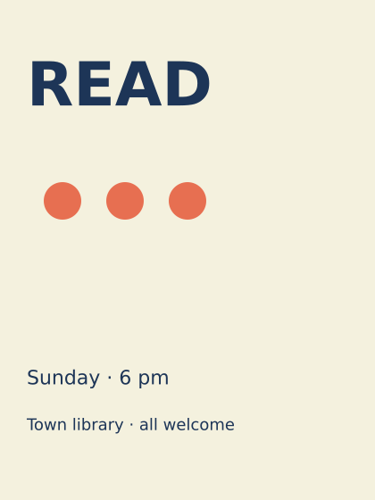
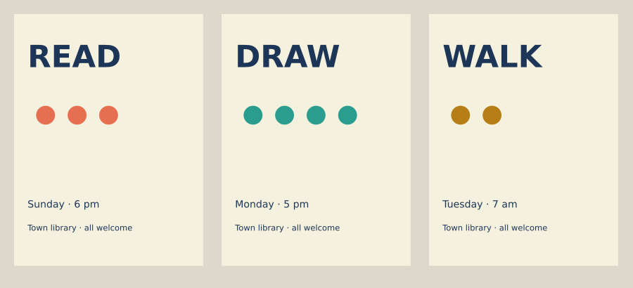

# Lesson 8 — Poster systems and messages

[← Lesson 7](07_cover.md) · [Course index](README.md#the-lessons) · [Lesson 9 →](09_motion_interaction.md)

**Question:** How do related posters belong together and remain distinct?

**Allow:** two sessions for a series and a revision.

You will design one poster, separate fixed rules from event information, and use a function
to make a family. The assignment tests the system with different content rather than
merely producing colour variations.

## 1. Start with the message

Imagine a viewer passing a notice board. They may give your poster only a short glance.
What should they understand immediately? What should they find on a second look?

Write the essential information before making an image: **what / when / where / action**.
For a fictional library programme, it might be a reading evening, its date and time,
the library location, and an invitation to attend.

Do not rely on a decorative symbol to explain an event if viewers cannot reasonably
know what it means. Image and words can support each other.

## 2. Establish one poster

Download [the starter](../../examples/course/08_starter.py):

```python
import funground as f

EVENT = ("READ", "Sunday · 6 pm", "#e76f51", 3)

def poster(event):
    title, date, accent, count = event
    f.no_stroke()
    f.fill("#f4f1de")
    f.rect(0, 0, 420, 560)
    f.fill(accent)
    for index in range(count):
        f.circle(70 + index*70, 225, 42)
    f.fill("#1d3557")
    f.text_align("left", "top")
    f.text_style("bold")
    f.text_size(68)
    f.text(title, 30, 55)
    f.text_style("normal")
    f.text_size(22)
    f.text(date, 30, 410)
    f.text_size(18)
    f.text("Town library · all welcome", 30, 465)

f.size(420, 560)
poster(EVENT)
f.save("08_starter.png")
f.show()
```



The event data is stored in a tuple. The function unpacks it into title, date, accent
and mark count. The rest of the layout is fixed for now.

A function gives repeated code one job. Here **poster(event)** draws a complete poster
from one event record. The same function can later accept another record.

First inspect the hierarchy: does the event word lead, and can you find date and venue?
Make one layout revision before multiplying the poster into a series.

## 3. Write the system down

A **design system** for this small series is a set of recurring choices. You do not need
a large framework; a few explicit rules are enough.

| Fixed in the example | Variable in the example |
|---|---|
| Paper colour and dark ink | Accent colour |
| Left margin and title position | Event word |
| Type sizes and styles | Date and time |
| Date and venue positions | Number of graphic marks |
| Shape vocabulary | Content appropriate to each event |

A system is useful when its rules work for the content it must carry. It should not force
every event into an identical message or hide an awkward case.

## 4. Experiment A: make a family



[Run the series comparison](../../examples/course/08_series.py).

The function is unchanged. A list supplies three event records, and a loop places each
poster on a comparison sheet. The saved-state block translates and scales the poster,
then restores the drawing state for the next one.

The function paints its paper with **f.rect(...)**. A global background call would repaint
the whole comparison sheet. This is why the individual poster uses a rectangle while
the outer sheet uses **f.background(...)**.

Look first at the family without reading. Then read the individual posters. Can you see
both the shared rules and the event differences?

## 5. Experiment B: stress the rules

Add a fourth event with a longer word, a longer date or a second venue line.
Do not change the function immediately.

What fails first: title width, footer height, graphic crowding or hierarchy?
This is useful evidence. A rule should be tested with demanding content.

Try one remedy:

- allow a title to use two lines;
- define a smaller title size for a clearly named long-title case;
- reserve more space for the footer;
- simplify the graphic when it competes with information.

Choose a rule you can apply again. Avoid silently changing unrelated coordinates for every
event, because then the function no longer expresses a consistent system.

<details>
<summary>If you want to check title width</summary>

Set the intended font size and style, then ask **f.text_width(title)** for the width.
Compare it with the available space. Measuring reveals a problem; it does not decide
whether a line break or size change is the better design response.

</details>

## 6. Guided practice: revise the family together

Choose one improvement, such as a clearer date or a stronger graphic region. Apply it
inside the shared function and regenerate all three posters.

Compare before and after. Did the improvement help the whole family, or only one event?
If one poster became weaker, ask whether it needs a content-specific exception or whether
the shared rule itself needs refinement.

This is one benefit of designing with code: a shared decision can be changed consistently.
It still needs visual judgement.

## 7. Make your own: three events and one difficult case

Choose a real or fictional programme. Make a brief for its audience and viewing conditions.

1. List the required information for three events.
2. Make one poster and establish its reading order.
3. Write at least three fixed rules and two permitted variables.
4. Put the drawing into a function.
5. Generate the series and compare it on one sheet.
6. Add a deliberately difficult fourth event to test the rules.
7. Revise, then export both the sheet and individual posters.

The fourth event is a design test, not a required fourth final poster.
Check long names and essential information before polishing decorative details.

**Optional extension:** make a square announcement using the same system. Keep its visual
identity but reconsider placement for the new frame; a crop of the portrait poster may
lose essential information.

## 8. Review and keep

Ask a viewer what connects the posters and what distinguishes the events. Ask them to find
the date and venue in each. Keep the rule list, comparison sheet and difficult-content test.

> The family shares ____. The events vary ____. The difficult case exposed ____.
> I changed the rule ____ because ____.

Continue when the system handles varied content and the shared identity supports, rather
than obscures, each message.

## Reference and further looking

Use [Text](../guide/06_text.md), [Transforms](../guide/08_transforms.md) and
[Saving your work](../guide/13_saving_your_work.md), plus the
[API reference](../reference/API.md).

Collect a small real-world poster family and describe its fixed and variable choices.
The course's follow-up Studios and Projects are linked in the [epilogue](epilogue.md).

---

[← Lesson 7](07_cover.md) · [Course index](README.md#the-lessons) · [Lesson 9 →](09_motion_interaction.md)
