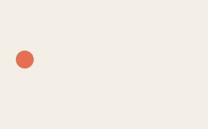
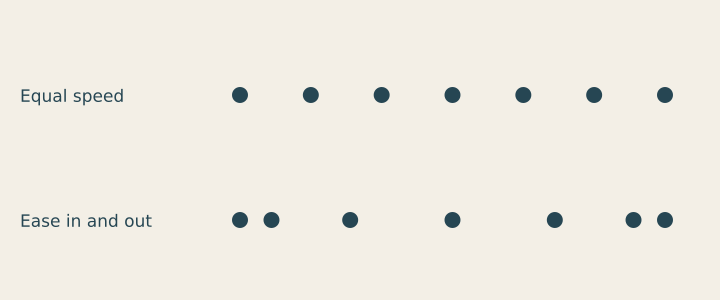
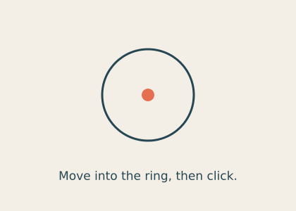

# Lesson 9 — Motion and interaction

[← Lesson 8](08_poster_systems.md) · [Course index](README.md#the-lessons) · [Lesson 10 →](10_rules_chance.md)

**Question:** How can movement and response carry an idea?

**Allow:** two sessions: one for motion, one for viewer response.

You will move one mark, compare timing and create a clear interactive response.
This is the first core lesson that needs a continuously running sketch rather than a
script that draws once.

## 1. Watch a change, not just an object

Notice an opening door, a moving lift indicator or a gently swinging object.
Describe where it moves, when it speeds up or slows down, and where it pauses.

Motion has **trajectory** (where it goes) and **timing** (how it travels through time).
The same route can feel abrupt, measured or gentle depending on timing.
More movement is not automatically more expressive. Stillness can let a viewer read.

## 2. Make one repeating journey

Download [the motion starter](../../examples/course/09_starter.py):

```python
import math
import funground as f

CYCLE_FRAMES = 120

def setup():
    f.size(420, 260, fps=60)

def draw():
    f.background("#f3efe6")
    phase = (f.frame_count % CYCLE_FRAMES) / CYCLE_FRAMES
    progress = (1 - math.cos(2 * math.pi * phase)) / 2
    f.no_stroke()
    f.fill("#e76f51")
    f.circle(50 + progress*320, 120, 36)
    f.fill("#264653")
    f.text_size(16)
    f.text("One mark, one repeating journey", 30, 210)
    if f.frame_count == 0:
        f.save("09_starter.png")

f.run()
```

The program has the structure explained in the Animation guide: **setup()** runs once,
**draw()** runs every frame, and **f.run()** starts the loop. Close the window to finish.

Here is a recorded loop with the same journey:



[Run the optional GIF exporter](../../examples/course/09_loop.py). GIF export requires
Pillow, available with **funground[extras]**, or a supported ffmpeg installation.
You can do the lesson using the live starter without exporting a GIF.

## 3. Follow the timing calculation

**frame_count % CYCLE_FRAMES** returns the position within the cycle. Dividing it by the
cycle length gives a phase from 0 toward 1. The cosine expression converts that phase
into a progress value that goes from 0 to 1 and back, slowing at each end.

**50 + progress * 320** maps that progress to the horizontal journey.
You do not need to derive cosine before experimenting, but you should understand the
inputs, output range and visible effect.

Change CYCLE_FRAMES to 60, then 240. At the requested 60 frames per second, those represent
nominal cycles of one and four seconds. Actual playback can be slower if frames take longer.
Keep size and trajectory fixed so you can judge timing.

Then reduce the travel distance from 320 to 100. Does the same timing still suit it?

<details>
<summary>If the circle leaves a trail</summary>

Check that **f.background(...)** runs at the start of every draw call. Without it, earlier
frames remain. A trail can be a deliberate effect, but here we want to compare one moving
mark clearly.

</details>

## 4. Experiment A: equal time, different spacing



[Run the timing study](../../examples/course/09_timing.py).

Each dot represents an equal step in time. Equal spacing means equal speed.
Dots closer together mean less distance travelled in that interval; wider gaps mean more.
The second row clusters samples near the ends and spreads them through the middle.

Before changing the formula, describe the movement you want: “begin gently, move quickly
through the middle, settle gently.” A named intention helps you evaluate the result.

**Guided practice:** give a word or simple symbol a motion that supports its meaning.
Try a short move, a pause and a return. Keep the text readable long enough for someone to
actually read it. Avoid relying on repeated fast flashing to create emphasis.

## 5. Interaction: make action and response understandable

An interaction gives a viewer an action and a consequence. Ask three questions:

- What suggests an action is possible?
- What tells the viewer they are in the right place?
- What changes when the action succeeds?

Download [the interactive ring](../../examples/course/09_interaction.py):

```python
import funground as f

opened = False

def inside_ring(x, y):
    return (x - 210)**2 + (y - 135)**2 < 65**2

def setup():
    f.size(420, 300)

def draw():
    hover = inside_ring(f.mouse_x, f.mouse_y)
    f.background("#f3efe6")
    f.no_fill()
    f.stroke("#2a9d8f" if opened else "#264653")
    f.stroke_width(8 if hover else 3)
    f.circle(210, 135, 130)
    f.no_stroke()
    f.fill("#e76f51")
    f.circle(210, 135, 55 if opened else 18)
    f.fill("#264653")
    f.text_align("center", "top")
    f.text_size(17)
    message = "Open. Click again to close." if opened else "Move into the ring, then click."
    f.text(message, 210, 240)
    if f.frame_count == 0:
        f.save("09_interaction.png")

def mouse_pressed():
    global opened
    if inside_ring(f.mouse_x, f.mouse_y):
        opened = not opened

f.run()
```



Move inside the ring: its stroke thickens. Click: the central mark grows and the ring
changes colour. Click again: it closes. The text describes the current state.

The hit test compares squared distance with squared radius; this avoids a square-root
calculation. **opened** stores the state. The click callback changes it once per press.

## 6. Experiment B: distinguish hover from activation

Move the mouse into and out of the ring without clicking. Then click outside it.
Finally, click inside it and move away.

Hover feedback should disappear when you leave. The opened state remains until the next
valid click. These are different jobs. If you changed opened in every draw call while the
mouse was held, it could toggle repeatedly instead of responding once.

Change one response at a time: stroke thickness, central size, colour or text.
Ask a first-time viewer to try the piece without an explanation. Do they understand the
action and notice the consequence? Automated execution cannot answer that question.

## 7. Make your own: an interactive visual invitation

Use a subject from your cover or poster. Give the viewer one understandable action:
hover, click, drag or a key press. Give it one visible consequence that relates to the idea.

1. Draw the initial, hover and activated states on paper.
2. Build the simplest action-response pair.
3. Add an instruction only where the action needs explanation.
4. Test with someone who has not watched you build it.
5. Revise one unclear cue or response.
6. If useful, add a brief movement to the response and compare it with the immediate change.

Keep a short recording or a set of state images. Explain what the viewer controls and
what the code controls. Do not add more input devices until the first interaction reads clearly.

**Optional extension:** provide a keyboard action for the same effect. Make its instruction
visible and ensure it changes the same state as the click.

## 8. Review and keep

Record the viewer's first action and their understanding of the response.

> The viewer can ____. The cue is ____. The response is ____.
> I changed the timing or feedback ____ because ____.

Continue when a viewer can discover the action and recognise that it worked, and you can
explain how timing supports the piece.

## Reference and further watching

Use [Animation and time](../guide/07_animation_and_time.md),
[Interaction](../guide/10_interaction.md), [Useful maths](../guide/12_useful_maths.md)
and [Saving your work](../guide/13_saving_your_work.md).
The [API reference](../reference/API.md) lists event names.

For optional further exploration, watch this video's [kinetic typography section](https://www.youtube.com/watch?v=o5t7PxRJSXk&t=2628s).
Observe timing and readability; give your own subject a different movement.

---

[← Lesson 8](08_poster_systems.md) · [Course index](README.md#the-lessons) · [Lesson 10 →](10_rules_chance.md)
