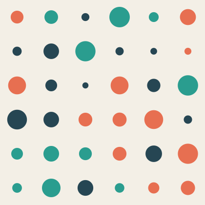
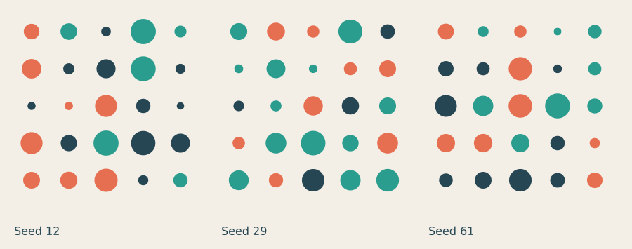
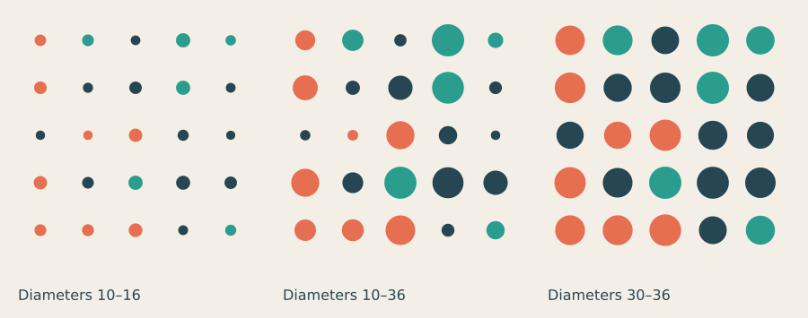

# Lesson 10 — Rules, chance and generative work

[← Lesson 9](09_motion_interaction.md) · [Course index](README.md#the-lessons) · [Lesson 11 →](11_capstone.md)

**Question:** How do rules, chance and selection shape a collection?

**Allow:** two sessions for exploration, selection and refinement.

You will make a repeatable generative image, vary its rules and curate a small edition.
The aim is to direct the range of possible results and judge them, rather than simply
produce many random pictures.

## 1. Name the decisions before adding chance

Return to your repeated-mark study. Which decisions did you fix: frame, mark, palette,
spacing, count or direction? Which decisions could vary without losing its character?

A **generative system** makes work by following rules. It can be deterministic or include
chance. The maker decides the rules, the allowed variation and what to keep.

A **seed** starts a repeatable random sequence. It lets you return to a result while you
adjust another rule. It does not freeze every possible source of variation; the sketch
must use the same random calls in the same order to reproduce the sequence.

## 2. Make a repeatable image

Download [the starter](../../examples/course/10_starter.py):

```python
import funground as f

SEED = 12
PALETTE = ["#264653", "#2a9d8f", "#e76f51"]

f.size(420, 420)
f.background("#f3efe6")
f.random_seed(SEED)
f.no_stroke()
for row in range(6):
    for col in range(6):
        diameter = f.random(12, 42)
        f.fill(f.random_choice(PALETTE))
        f.circle(35 + col*70, 35 + row*70, diameter)
f.save("10_starter.png")
f.show()
```



The grid locations are fixed. Diameter and palette choice vary. The seed is set before
the random calls, so rerunning this static script with the same code reproduces the image.

Run twice unchanged. Then set SEED to 29 and save another filename.
Change it back to 12. You should return to the original.

The code makes two random decisions per mark. Adding another random call inside the loop
changes the sequence used by later marks. Keep code as well as seed when preserving a result.

## 3. Experiment A: new seed, same rules



[Run the seed comparison](../../examples/course/10_seeds.py).

Before choosing a favourite, describe each image: which areas are dense, which colours
cluster, where the larger marks sit. Ask whether the differences are meaningful for your
subject or merely interchangeable decoration.

Try six seeds. Record each seed with a short observation. Select two that differ in a
way you can describe, not just “this one feels better.”

<details>
<summary>If every run changes unexpectedly</summary>

Check where you set the seed. In an animated sketch, setting it only in setup does not
stop draw from consuming more random values each frame. For a stable printed image,
a static script is simplest. Alternatively, reset the seed before drawing the whole
image in each frame.

</details>

## 4. Experiment B: change the permitted range



[Run the bounds comparison](../../examples/course/10_bounds.py).

The seed, grid and palette remain fixed. The allowed diameter range changes.
The middle version has the greatest size contrast; the right has larger, more uniform
marks. These rules change the character of the whole family, not just one chosen image.

Try a tighter palette or three discrete sizes:

```py
diameter = f.random_choice([14, 26, 38])
```

Replace the diameter calculation with that line. Because the random decision has changed,
do not expect every mark to correspond exactly with the previous image. Evaluate the
new family on its own terms.

## 5. Guided practice: purposeful constraints

Write a brief such as “a light, open collection suggesting scattered notes.”
Choose rules that could support it: generous spacing, modest sizes, few colours and
one controlled accent. Make a competing rule set that suggests density.

Generate several images from each. What does the rule set consistently deliver?
If it only works for one lucky seed, refine the rules before searching for hundreds more.

For smoother neighbouring changes, you can explore noise:

```py
f.noise_seed(12)  # put this before the loops
# Inside the loops:
diameter = 12 + 30 * f.noise(col * 0.35, row * 0.35)
```

Place the seed line before the loops and the diameter line inside them, replacing the existing diameter calculation.

Random samples jump independently; noise changes more smoothly as nearby inputs change.
The [Randomness and noise guide](../guide/11_randomness_and_noise.md) explains the details.
Treat this as an optional visual experiment, not a requirement for the edition.

## 6. Make your own: curate an edition

1. Choose a subject or visual intention.
2. Write fixed rules and permitted variables.
3. Generate 12 outputs and retain their code, seeds and parameters.
4. Put them on a contact sheet or arrange the saved files together.
5. Select three that belong together but contribute distinct qualities.
6. Give the collection a title and each selection a short observation.
7. Refine a rule if the collection's character relies mainly on lucky accidents.

Use filenames that retain the seed, or record it beside the output.
Do not claim the seed is the entire recipe: the code version, palette and ranges matter too.

<details>
<summary>If selecting feels arbitrary</summary>

Define one selection question: balance, openness, accent placement or relationship to
the subject. Reject an image that fails that question even if it is attractive.
Then compare the remaining images for what each adds to the edition.

</details>

**Optional extension:** export the same selections as SVG or PDF for print.
Inspect them at intended size; an attractive thumbnail may not justify a large print.

## 7. Review and keep

Keep all 12 previews, the selected three and the rule record.

> The system fixes ____. Chance varies ____. I selected these because ____.
> Changing the rule ____ made the family ____.

Continue when you can reproduce a selection and explain how both the rules and your
curation shaped it.

## Reference and further looking

Use [Randomness and noise](../guide/11_randomness_and_noise.md),
[Saving your work](../guide/13_saving_your_work.md) and the
[API reference](../reference/API.md).

[Coding Art](https://learning.oreilly.com/library/view/coding-art-the/9781484262641/)
and [Code as Creative Medium](https://mitpress.mit.edu/9780262542043/code-as-creative-medium/)
offer optional further reading on creative-programming practice.
Observe their approaches and develop your own rules and subjects.

---

[← Lesson 9](09_motion_interaction.md) · [Course index](README.md#the-lessons) · [Lesson 11 →](11_capstone.md)
