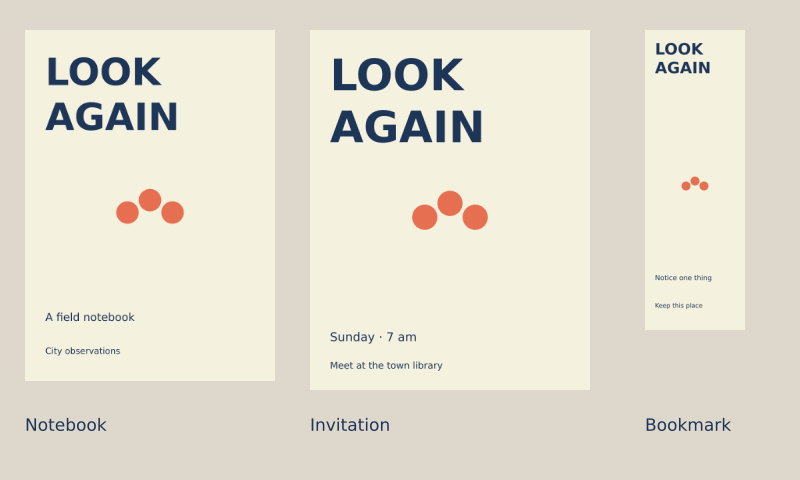

# Lesson 11 — Make a small visual world

[← Lesson 10](10_rules_chance.md) · [Course index](README.md#the-lessons) · [Epilogue →](epilogue.md)

**Question:** Can you bring the ideas together for a subject you care about?

**Allow:** three or more sessions: intention, directions, making, review and refinement.

Your capstone is a connected set of three pieces. It should show a clear purpose, a shared
visual language and appropriate differences between formats. The process matters as much
as the final files: keep the decisions that explain how you got there.

## 1. Choose a subject with room to explore

Choose a place, story, community event, collection, imaginary product or feeling.
It should matter enough to you that you can make choices beyond the demonstration's style.

Write a brief in five sentences:

1. My subject is ____.
2. The work is for ____.
3. I want that person to notice or understand ____.
4. I will make these three pieces: ____.
5. My useful constraint is ____.

Possible sets include a book cover, poster and bookmark; a poster, interactive invitation
and short loop; or three pages from a small publication. Choose formats with distinct jobs.
Three randomly different images do not automatically make a coherent world.

## 2. A worked example: Look Again

Imagine a local walking group that encourages people to notice ordinary streets.
It needs a field notebook, a public invitation and a bookmark reminding readers to observe.
The audience should read the invitation quickly and use the other pieces more slowly.

The example chooses pale paper, dark words, a warm accent, bold stacked titles and three
simple marks. Those rules recur; proportions and information change for each format.



[Download the complete worked example](../../examples/course/11_starter.py).

This is a starter for studying the process. Your capstone should have its own subject,
rules and decisions; it need not resemble these three pieces.

## 3. Read the code as decisions

```python
import funground as f

PAPER = "#f4f1de"
INK = "#1d3557"
ACCENT = "#e76f51"

def marks(cx, cy, size):
    f.no_stroke()
    f.fill(ACCENT)
    f.circle(cx-size, cy, size)
    f.circle(cx, cy-size*0.55, size)
    f.circle(cx+size, cy, size)

def piece(width, height, margin, title_size, subtitle, footer, name):
    f.size(width, height)
    f.background(PAPER)
    f.fill(INK)
    f.text_align("left", "top")
    f.text_style("bold")
    f.text_size(title_size)
    f.text("LOOK", margin, margin)
    f.text("AGAIN", margin, margin+title_size*1.2)
    marks(width/2, height*0.52, width*0.09)
    f.fill(INK)
    f.text_style("normal")
    f.text_size(max(11, width*0.045))
    f.text(subtitle, margin, height-90)
    f.text_size(max(10, width*0.035))
    f.text(footer, margin, height-45)
    f.save(name)

piece(320, 450, 26, 48, "A field notebook", "City observations", "11_cover.png")
piece(420, 540, 30, 65, "Sunday · 7 am", "Meet at the town library", "11_poster.png")
piece(160, 480, 16, 25, "Notice one thing", "Keep this place", "11_bookmark.png")

f.size(800, 480)
f.background("#ded8cc")
for name, x, y, width, height, caption in [
    ("11_cover.png", 25, 30, 250, 351, "Notebook"),
    ("11_poster.png", 310, 30, 280, 360, "Invitation"),
    ("11_bookmark.png", 645, 30, 100, 300, "Bookmark"),
]:
    f.image(f.load_image(name), x, y, width, height)
    f.fill(INK)
    f.text_align("left", "top")
    f.text_style("normal")
    f.text_size(17)
    f.text(caption, x, 415)
f.save("11_starter.png")
f.show()
```

**marks(...)** draws the repeating image vocabulary.
**piece(...)** applies shared choices but accepts format-specific size, title size and text.
The three calls make different files. The final block loads those files onto a comparison
sheet. All images in the sheet are made by this sketch.

Notice the different jobs: the poster carries meeting information; the notebook identifies
its subject; the bookmark gives a small reminder. They use a shared language without
carrying identical content.

**Guided practice:** change ACCENT once and rerun. It changes the family consistently.
Then change only the poster's subtitle. That is a content change, so the other pieces remain
the same. Explain which decisions belong at family level and which belong to one format.

## 4. Gather observations, then make directions

Collect words, shapes, textures, colours or movement related to your subject.
For each reference, note one thing you see and one question it raises. Do not reproduce
a finished design from a book or tutorial.

Make at least six thumbnails. Try more than cosmetic variations:

- image leading versus words leading;
- dense versus open;
- literal symbol versus abstract relationship;
- steady repetition versus one interruption.

Choose two directions and write what each promises the audience. Develop small tests
before committing to a full set.

<details>
<summary>If you do not know which direction to choose</summary>

Return to the brief. Ask which direction makes the intended message or experience easier
to find. Show the two directions to someone in or near the intended audience.
Record their reading before explaining yours.

</details>

## 5. Define a small visual system

Write the choices you will carry across the pieces:

| Choice | Your rule |
|---|---|
| Palette | Paper, ink and accent roles |
| Typography | Main and supporting sizes, styles and alignment |
| Spacing | Margins and relationships between image and words |
| Image language | Shapes, contours, texture or pattern |
| Variation | What may change between pieces |
| Motion or input, if used | What it contributes to the subject |

Keep the list short enough to apply. A system that needs dozens of exceptions may be
solving the wrong problem or trying to do too much.

Make the first piece. Compare it with your thumbnail and brief. Only then develop the
other two. A function can hold shared drawing decisions, as in Lesson 8, while each
format supplies its own content and placement.

## 6. Make the formats genuinely work

Test each piece in its intended situation:

- Cover: does the title and promise survive at thumbnail size?
- Poster: can a viewer find the event, time and place?
- Publication page: does all the text fit and read comfortably?
- Motion: does timing support the idea and leave time to read?
- Interaction: can a new viewer discover the action and recognise its effect?
- Generative collection: can you reproduce and explain the selected outputs?

You do not need every format in one capstone. Use the tests that match your choices.

If a format needs different spacing or proportion, adapt it. Shared identity does not
require scaling one layout into every frame.

## 7. Review without defending the first version

Show the work at intended size. Ask:

1. What did you notice first?
2. What do you think this is for?
3. Which pieces feel connected, and why?
4. What is difficult to read or understand?

For an interactive piece, observe the first action before giving instructions.
For print-oriented work, inspect a print or a realistic size preview when possible.

Write the answers down. Choose one revision that addresses the most important communication
problem. Then review again. You decide what feedback serves the brief, but give the
evidence a fair chance before explaining away an unexpected reading.

## 8. Prepare the presentation

Deliver three final pieces and a compact process record:

- the brief;
- one early thumbnail or version;
- the shared rule list;
- one meaningful before/after comparison;
- final files and source code;
- seeds and parameters if randomness is involved.

Explain one decision in ordinary language:

> I wanted the viewer to ____. The first version made them notice ____.
> I changed ____ and the next test showed ____.

Export for the actual use. Keep editable source files as well as the final PNG, vector
file or recording. Check the export itself: text, cropping, page size and looping can
differ from the working preview.

## 9. Decide when it is ready

Your capstone is ready to present when:

- its purpose is understandable to the intended audience;
- each piece works in its own format;
- the shared choices visibly connect the set;
- you have evidence of comparison and revision;
- the code runs and you can find the rule behind an important visual choice.

Complexity is not the target. A simple set with clear decisions can show more learning
than an elaborate set whose choices you cannot explain.

## Reference and further work

Return to the relevant [guide chapters](../guide/README.md) and
[API reference](../reference/API.md). Use the [epilogue](epilogue.md) to review the portfolio,
choose further reading and continue into the follow-up exercises.

---

[← Lesson 10](10_rules_chance.md) · [Course index](README.md#the-lessons) · [Epilogue →](epilogue.md)
