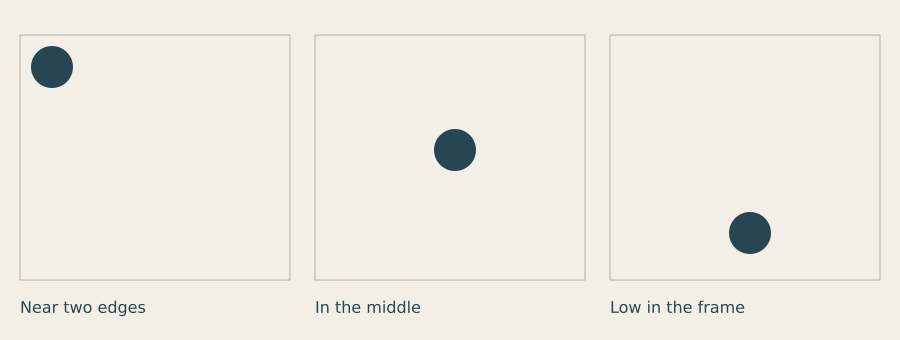

# Creative Thinking Course

**Learn to see, choose and make with code.**

A circle near an edge can feel different from the same circle in the middle. A small bright
mark can attract more attention than a large quiet one. A title becomes easier to find when
its size and surrounding space give it a clear place in the composition.

This course helps you notice these relationships, test them and use them in your own work.
You will begin with a few marks and finish by bringing image, words, rules and movement together.



*Nothing about the circle changes here. Only its relationship to the frame changes.
What do you notice in each panel? Lesson 1 starts with that question.*

## Where this course fits

Begin with [Getting started](../guide/01_getting_started.md) so you can run a sketch.
Then work through this course, using the [guide](../guide/README.md) and
[API reference](../reference/API.md) when you need help with a drawing function.
The Studio exercises follow the course; related links are collected in the epilogue.

You can begin with basic Python: variables, function calls and the ability to run a file.
No art or design training is assumed. Early lessons use short scripts that draw once.
Later lessons introduce loops, functions, motion and input as the visual task needs them.

## What you will make

You will keep a small collection of compositions, colour studies, symbols, patterns and
typographic cards; develop a cover and poster series; explore motion, interaction and
generative work; and finish with a connected set of three pieces on a subject you choose.

The aim is to make choices you can explain. You do not have to develop one particular style,
and you do not have to make complex code to make an interesting image.

## The lessons

Each lesson has a guided explanation, runnable code, rendered outputs, experiments and an assignment.
Work through the lessons in order, or revisit one when a later project exposes a question.

| Lesson | Question | Page |
|---|---|---|
| 1 | How does the space around a mark change what we see? | [Look, frame and compose](01_look_frame_compose.md) |
| 2 | What attracts attention, and how do unlike elements balance? | [Visual weight, balance and hierarchy](02_weight_balance_hierarchy.md) |
| 3 | How can contrast and a limited palette make a message clearer? | [Contrast and colour](03_contrast_colour.md) |
| 4 | Which features make a shape recognisable? | [Shape, figure and ground](04_shape_figure_ground.md) |
| 5 | How can a repeated mark feel steady, lively or interrupted? | [Repetition, rhythm and variation](05_rhythm_variation.md) |
| 6 | How can words acquire a clear order and voice? | [Type, words and hierarchy](06_type_hierarchy.md) |
| 7 | What should a cover promise its intended reader? | [Make a cover](07_cover.md) |
| 8 | How do related posters belong together and remain distinct? | [Poster systems and messages](08_poster_systems.md) |
| 9 | How can movement and response carry an idea? | [Motion and interaction](09_motion_interaction.md) |
| 10 | How do rules, chance and selection shape a collection? | [Rules, chance and generative work](10_rules_chance.md) |
| 11 | Can you build a consistent visual world of your own? | [Capstone](11_capstone.md) |
| Afterwards | What have you learned, and where can you take it? | [Epilogue](epilogue.md) |

## How to work through a lesson

Allow about 60–90 minutes for a foundational lesson, with another session if you want
to develop the assignment. Later projects may need several sessions. Work at a pace that
lets you compare and revise.

1. **Look:** name a visible choice before interpreting it.
2. **Predict:** say what you expect a change to do.
3. **Make:** run the small experiment.
4. **Compare:** describe the difference between versions.
5. **Choose:** keep a version and explain why.
6. **Extend:** use the idea for a subject of your own.

Make a folder for each lesson. Save the Python files and exported images there. Keep a short
note with four lines: **My question / What I changed / What I noticed / What I will try next.**
Keep early versions: they show how you arrived at your choice.

If a sketch fails, return to the last working version and make one change at a time.
Use [When something goes wrong](../guide/errors.md) for code problems.
For a visual problem, first reduce the number of marks or colours so you can see the
relationship you are trying to change.

## Sketches and outputs

[Download all course sketches as a ZIP](downloads/course_sketches.zip), or choose an
individual sketch from the [download list](../../examples/course/README.md).
Every course output illustration is rendered from its linked Funground sketch.

To run a downloaded file, use the same Python environment in which you installed Funground:

```sh
python 01_starter.py
```

If your computer uses a different Python command or a virtual environment, use the command
from your working first sketch. A window opens, and the script also saves a PNG in the
folder from which you ran it. Close the window to finish. The core examples use Funground's base install. The optional GIF exporter in Lesson 9
requires Pillow (funground[extras]) or ffmpeg.

The early lessons use plain drawing calls so that the visual idea is easy to isolate.
Functions and loops in the comparison sketches simply arrange several studies on one sheet;
you can study those after making the single composition.

**[Begin Lesson 1 →](01_look_frame_compose.md)**
