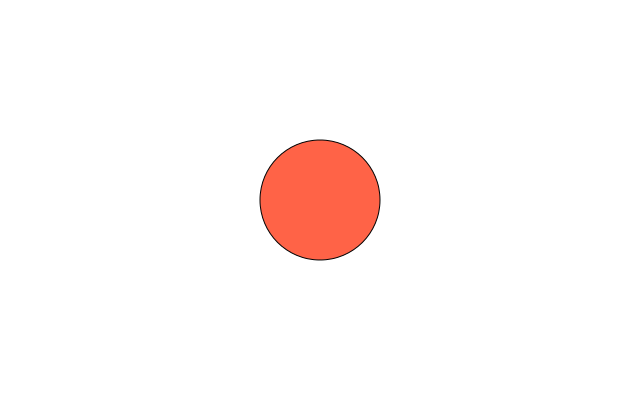
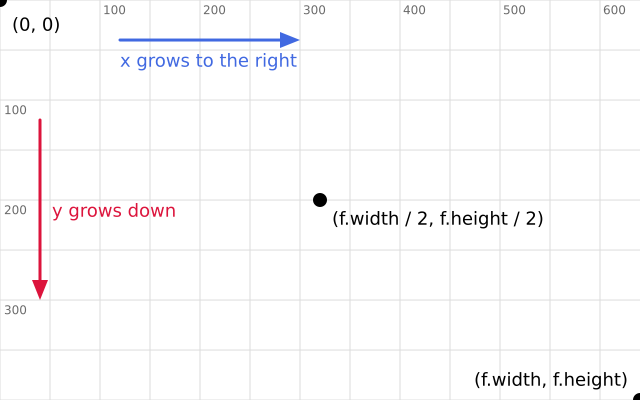

# 1. Getting started

funground is a small Python library for drawing and animation. You write a short Python file,
run it, and a window opens with your picture in it.

## Install

You need Python 3.11 or newer. In a terminal, in the folder where you keep your sketches:

```py
python -m venv .venv
.venv\Scripts\activate        # Windows;  on macOS/Linux:  source .venv/bin/activate
python -m pip install funground
```

On Linux, install the Cairo library first: `sudo apt install libcairo2-dev pkg-config python3-dev`
(Debian or Ubuntu; other distributions have an equivalent package).

## Your first sketch

Save this as `first.py` and run it with `python first.py`:

```python
import funground as f


def setup():
    f.size(640, 400)


def draw():
    f.background("white")
    f.fill("tomato")
    f.circle(320, 200, 120)


f.run()
```

We write `import funground as f` and then use `f.` in front of every funground command. Don't use
`f` as a name for your own variables, for example `with open(...) as f:` — that would hide
funground, and the next `f.circle(...)` would fail.



- `import funground as f` — every funground function starts with `f.`
- `setup()` runs once at the start; `f.size(640, 400)` opens a window 640 pixels wide and 400 high.
- `draw()` runs again and again, about 60 times a second. Here it paints the background white,
  chooses a tomato-red fill and draws a circle.
- `f.run()` starts everything. It finds your `setup()` and `draw()` by their names.

Press **Escape** or close the window to stop.

## Where things are

Every position in funground is a pair of numbers, `x` and `y`, counted in pixels.



The picture shows how it works. The origin, `(0, 0)`, is the **top-left** corner. `x` grows to the
right. `y` grows **down**. In a graph from maths class, `y` goes up, so this is the other way round.

`f.size(640, 400)` sets the width and the height of the picture. `f.width` and `f.height` give the
two numbers back. Use them instead of typing 640 and 400 again. Then your sketch keeps working if
you change the size. The centre is `(f.width / 2, f.height / 2)`, and the bottom-right corner is
`(f.width, f.height)`.

A shape that goes past the edge of the window is cut off. A shape that is wholly outside is not
seen. Neither one is an error.

Sizes are in pixels. On a high-resolution screen, such as a Retina display or a Windows screen with
scaling, your numbers mean the same thing and the picture looks the same, only sharper.

You can try the map yourself: the code is in the
[gallery](../gallery/README.md#where-things-are-a-map-of-the-canvas) as `05_where_things_are.py`.
To see the numbers change as you move, run `06_mouse_position.py` from the gallery. It shows
`f.mouse_x` and `f.mouse_y`. (How to run a gallery example is explained just below.)

## More examples

The [Examples Gallery](../gallery/README.md) shows every part of funground with a picture and
the code that makes it. To browse it in a window, run `python -m funground.gallery`
(the Projects at the top are the best place to start). Click
a picture to read its code, press **Enter** to run it, and press **C** to copy it into your folder.
Files an example saves go to a temporary folder. The browser tells you where, and the **O** key opens that folder.

## See also

- Gallery: [Basics](../gallery/README.md#basics), or browse every example with `python -m funground.gallery`.
- Quick Reference: [1. The basic idea](../reference/Quick_Reference.md#1-the-basic-idea).
- Stuck? [When something goes wrong](errors.md) lists the messages you are most likely to see. Words you do not know are in the [glossary](glossary.md).

## Try it

1. Change `"tomato"` to another colour name, such as `"teal"`, and run the sketch again.
2. Move the circle to the top-left corner, then to the bottom-right corner. Use `f.width` and `f.height` for the second one.
3. Draw a second shape after the circle with `f.rect(40, 40, 100, 60)`. What happens if you draw it *before* the circle?
4. Put a small circle in each of the four corners. Use `0`, `f.width` and `f.height` for their positions. Half of each circle is cut off. Why?
5. Change `f.size(640, 400)` to `f.size(300, 300)`. Does the circle in the middle stay in the middle if you use `f.width / 2` and `f.height / 2` for its position?

**Next:** [2. The sketch: setup, draw and run](02_the_sketch.md)
