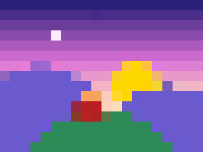
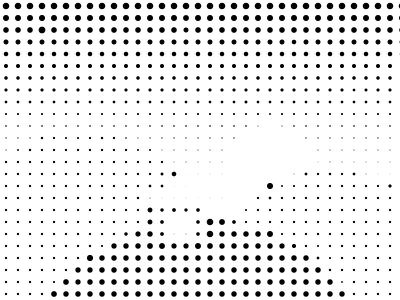
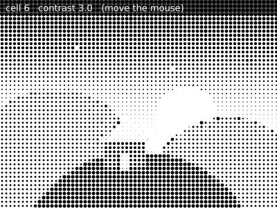
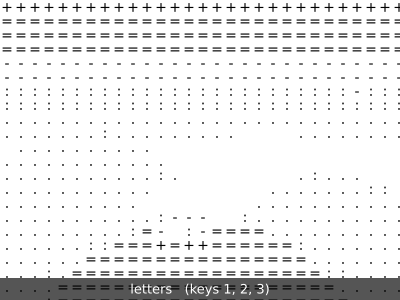
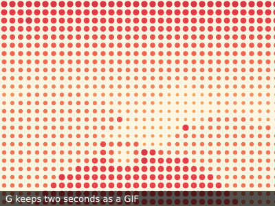

# Project 10: From pixels to marks

A photo is a grid of coloured dots too small to see. In this project you read that grid and draw it again with
marks of your own: squares, dots, letters, lines, words. Six short steps, each a complete sketch that runs in Play.
By the end your camera turns you into a print, and you choose the marks and the colours.

Before each step, **predict** what you will see. Then run it and **compare** with your guess. The surprise, when
there is one, is where you learn the most.

## Step 1: a grid of colours

**Predict:** the photo is read once every 20 pixels, and each reading becomes a square. Will you still recognise
the picture?



[From pixels to marks, step 1](../../gallery/README.md#from-pixels-to-marks-step-1-a-grid-of-colours) in the
gallery. `photo.get(x, y)` gives the colour at one point of a picture. Two loops walk over the canvas, one cell at a
time, and fill a square with the colour at the cell's centre.

```py
for y in range(0, 300, CELL):
    for x in range(0, 400, CELL):
        f.fill(photo.get(x + CELL // 2, y + CELL // 2))
        f.rect(x, y, CELL, CELL)
```

**Compare:** change `CELL` to 10 and to 40. At which size does the house stop being a house?

## Step 2: dots by brightness

**Predict:** now each cell is a black dot, and only its size changes. Will the dark parts of the photo have big dots
or small ones?



[Step 2](../../gallery/README.md#from-pixels-to-marks-step-2-dots-by-brightness). `colour.brightness` is a number
from 0 (black) to 100 (white), and `f.map_range()` turns it into a diameter: dark gives the whole cell, light gives
nothing. Printers call this **halftone**.

**Compare:** look at the picture from a few steps away, or make the window small. When do the dots disappear into a
picture?

## Step 3: the live camera

**Predict:** only the line that chooses the picture changes. What else in the code has to change for the camera?

[Step 3](../../gallery/README.md#from-pixels-to-marks-step-3-the-live-camera). The drawing moves into `draw()`, and
`cam.picture()` gives the camera's latest frame as a picture: the loops do not change at all. With no camera it keeps
using the photo.

**Compare:** move closer to the camera, then further away. Which works better as dots: a face that fills the
picture, or a whole person?

## Step 4: grid and contrast

**Predict:** contrast here is a power. Brightness from 0 to 1, raised to the power 3, comes out smaller. Will the
picture get darker or lighter?



[Step 4](../../gallery/README.md#from-pixels-to-marks-step-4-grid-and-contrast). The mouse holds the controls: left
and right change the size of the cells, up and down the contrast. The settings are shown at the top.

**Compare:** find the settings you like best for your face, and for the room behind you. Are they the same?

## Step 5: other marks

**Predict:** in letters, dark cells get dense characters like `@` and light cells a dot or a space. Will it still look
like a picture, or like text?



[Step 5](../../gallery/README.md#from-pixels-to-marks-step-5-other-marks). Keys 1, 2 and 3 choose letters, short
lines that turn with brightness, or the words of a sentence sized by darkness. The grid and the brightness stay the
same; only the mark changes, and it changes the picture's voice.

**Compare:** which mark suits a face, and which a landscape? Write your own sentence into `WORDS` and look again.

## Step 6: a palette and a GIF

**Predict:** only three colours, blended from dark to light. Will the picture look richer or poorer than the photo?



[Step 6](../../gallery/README.md#from-pixels-to-marks-step-6-a-palette-and-a-gif). `f.lerp_color()` blends
between neighbouring colours of `PALETTE`, so the colours follow brightness smoothly. Press G to keep two seconds as
a GIF.

**Compare:** try two palettes, one of close colours and one of opposites. Which makes the stronger picture?

## Make it yours

- Choose one mark and one palette and make a portrait series: three people, or one person three times.
- Read the colour of each cell from the photo and the size from its brightness, together.
- Mix marks: letters where it is dark, dots where it is light.
- Keep the versions you like with `f.keep("why I kept it", cell=12)`: the picture, the code and the settings are saved
  together.

## Further looking

The p5.js tutorial [Chatting with/about Code](https://p5js.org/tutorials/criticalAI1-chatting-with-about-code/) by
Sarah Ciston, Emily Martinez and Minne Atairu builds a webcam halftone in p5.js, and is also about using an AI chat
assistant with care. The code in this project is funground's own.

## See also

- Gallery: [Pixels to marks](../../gallery/README.md#pixels-to-marks).
- Guide: [Paths, clipping and pictures](../09_paths_and_clipping.md) for pictures, `get()` and the camera.
- Quick Reference: pictures and the camera.
