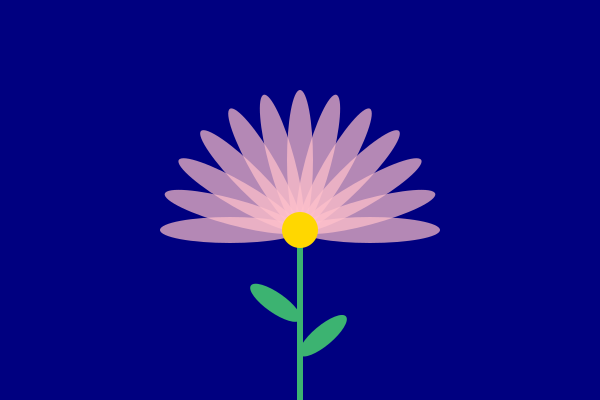
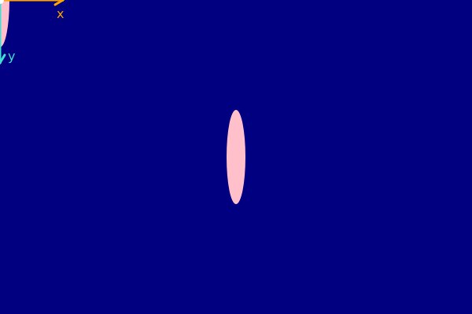
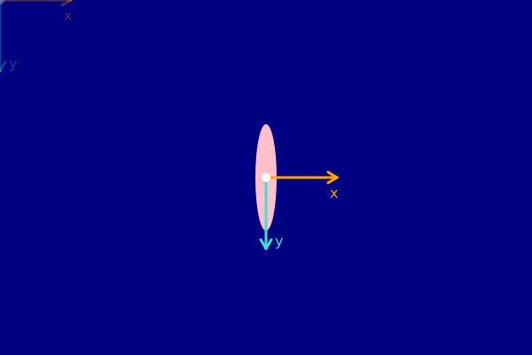
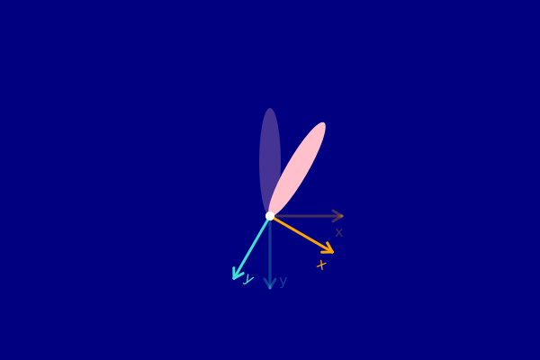
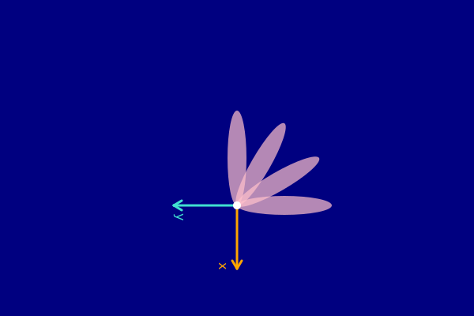
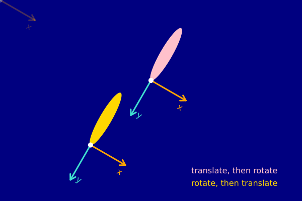
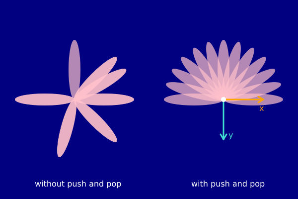
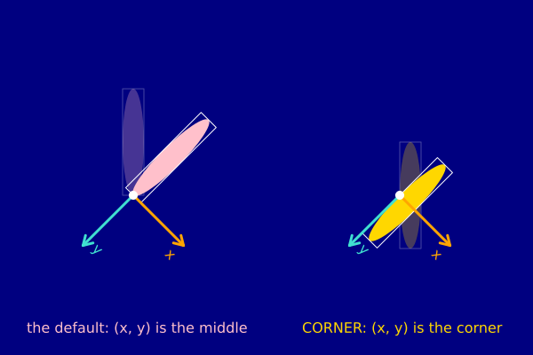

# Project 11: Moving the paper

`translate()`, `rotate()`, `push()` and `pop()` are easy to type and hard to picture. This project builds one idea,
step by step, until a flower like this one is easy to draw and to change:



**The idea: you never move the shape. You move the paper.** `translate()` slides the paper under the pen,
`rotate()` turns it, and every shape is drawn on the paper where it is now. `push()` remembers where the paper is,
and `pop()` puts it back there.

There are eight steps. Each one is a complete sketch that opens in Play. Every sketch draws the paper's own arrows,
so you can always see where the paper is:

- the **orange arrow** is the paper's x direction,
- the **turquoise arrow** is its y direction,
- the **white dot** is the paper's (0, 0).

A faded copy of the arrows shows where the paper was before a move.

**How to work through it.** Before each step, **predict** what you will see, out loud or on paper. Then run it and
**compare** with your guess. Then **experiment**: each step lists changes to try, and each change is a small
prediction of its own. A surprise is where you learn the most, so do not skip the guesses. At the end there are
exercises, with answers you can open when you have tried.

## The arrows: `axes()`

Every step starts with this small function. It is plain funground, so you can copy it into your own sketches:

```py
def axes(faded=False, size=80):
    """Draw the paper's x arrow (orange) and y arrow (turquoise) from its (0, 0)."""
    f.push()
    f.opacity(70 if faded else 255)
    f.stroke_width(3)
    f.stroke("orange")
    f.line(0, 0, size, 0)                 # the x arrow, with its head
    f.line(size, 0, size - 10, -6)
    f.line(size, 0, size - 10, 6)
    f.stroke("turquoise")
    f.line(0, 0, 0, size)                 # the y arrow, with its head
    f.line(0, size, -6, size - 10)
    f.line(0, size, 6, size - 10)
    f.stroke("white")
    f.stroke_width(10)
    f.point(0, 0)                         # the paper's (0, 0): a round dot
    f.no_stroke()
    f.text_size(16)
    f.fill("orange")
    f.text("x", size - 8, 8)
    f.fill("turquoise")
    f.text("y", 10, size - 18)
    f.pop()
```

It draws from (0, 0), so the arrows are wherever the paper is. It begins with `push()` and ends with `pop()`, so it
changes nothing for the rest of your sketch. Step 6 explains why that works.

## Step 1: where is (0, 0)?

**Predict:** two petals, both `ellipse(x, y, 24, 120)`. The first is at (0, 0), the second at (300, 200), on a
canvas 600 wide and 400 high. Where will each one be, and how much of each can you see?



<a href="../../../play/?example=paper-01_where_is_zero">Open step 1 in Play</a>

```py
f.ellipse(0, 0, 24, 120)          # middle at (0, 0): mostly off the canvas
f.ellipse(300, 200, 24, 120)      # middle at (300, 200): the middle of the canvas
axes()
```

Before any move, the paper lies exactly on the canvas: (0, 0) is the **top-left corner**, x grows to the right and
**y grows downwards**. `ellipse()` puts the **middle** of the ellipse at (x, y), so the first petal's middle is on
the corner, and three quarters of it are off the canvas. The arrows sit on the corner too, half hidden.

**Compare:** did you expect to see the whole first petal? Most people do.

**Experiment:**

- Move the first petal to (60, 60). Which way did it move?
- Swap the petal's width and height: `ellipse(300, 200, 120, 24)`. Which way does it lie now?
- Draw a third petal at (600, 400). How much of it can you see, and why?

## Step 2: `translate` slides the paper

**Predict:** this step draws the *same* petal as step 1's first one, `ellipse(0, 0, 24, 120)`, but after
`translate(300, 200)`. Where will it be?



<a href="../../../play/?example=paper-02_translate_slides_the_paper">Open step 2 in Play</a>

```py
axes(faded=True)                  # the paper before the move
f.translate(300, 200)             # slide the paper 300 to the right and 200 down
f.ellipse(0, 0, 24, 120)          # the same call as step 1's first petal
axes()                            # the paper after the move
```

The petal is in the middle, and the call did not change. **The paper moved**: `translate(300, 200)` slid it 300
to the right and 200 down, so its (0, 0), the white dot, is now in the middle of the canvas. Everything drawn after
`translate()` is drawn on the moved paper. The arrows still point the same way: sliding does not turn.

**Compare:** look at the faded arrows and the bright ones. The distance between the two white dots is the
translate.

**Experiment:**

- Change `translate(300, 200)` to `translate(100, 300)`. Where does the petal go?
- Add a second `translate(100, 0)` after the first. Do the two moves add up? Where are the arrows now?
- Try `translate(-100, 0)` after the first. Which way does the paper go?
- Draw a petal at (50, 0) after the translate. Is 50 measured from the corner or from the dot?

## Step 3: `rotate` turns the paper around its (0, 0)

**Predict:** a petal pointing up from the dot, then `rotate(30)`, then the same petal again. Which way will it
turn: clockwise or anticlockwise? Will it turn around its own middle, or around the dot?



<a href="../../../play/?example=paper-03_rotate_turns_the_paper">Open step 3 in Play</a>

```py
f.translate(300, 240)             # slide the paper first, so its (0, 0) is in view
f.ellipse(0, -60, 24, 120)        # before the turn: a petal pointing up from (0, 0)
f.rotate(30)                      # turn the paper 30 degrees clockwise around its (0, 0)
f.ellipse(0, -60, 24, 120)        # the same call, on the turned paper
```

First a new kind of petal. `ellipse(0, -60, 24, 120)` is 120 long, and its middle is 60 *above* the dot (up is
negative y). So it starts at the dot and points up, like a petal growing from the middle of a flower.

`rotate(30)` turns the paper **30 degrees clockwise** around **its (0, 0)**. Angles in funground are in degrees, and
a positive angle turns clockwise on the screen. The petal swings around the dot, like the hand of a clock, because
the dot is where the paper is pinned. Both arrows turn with the paper.

**Compare:** did it turn the way you guessed? If you expected anticlockwise, that is the maths-class habit: there,
y grows upwards. On the screen y grows downwards, so a positive turn goes clockwise.

**Experiment:**

- Change 30 to 90, to 180, to -30 and to 360. Which way does a negative angle turn? Where does 360 leave the petal?
- **Remove the `translate()` line.** The paper is now pinned at the top-left corner of the canvas. Where did the
  petal go? This is the most common surprise with `rotate()`.
- Change the petal to `ellipse(0, 0, 24, 120)`. Why does the turn now look like a spin in place?

## Step 4: turns add up

**Predict:** a petal, `rotate(30)`, a petal, `rotate(30)`, a petal, `rotate(30)`, a petal. How many petals, and
how far apart? Which way will the arrows point at the end?



<a href="../../../play/?example=paper-04_turns_add_up">Open step 4 in Play</a>

```py
f.ellipse(0, -60, 24, 120)        # no turn yet: straight up
f.rotate(30)
f.ellipse(0, -60, 24, 120)        # 30 degrees in all
f.rotate(30)
f.ellipse(0, -60, 24, 120)        # 60 in all: this rotate adds to the one before
f.rotate(30)
f.ellipse(0, -60, 24, 120)        # 90 in all
axes()
```

Each `rotate()` turns the paper **from where the last one left it**. Nothing goes back by itself. So the turns add
up: 30, then 60, then 90 in all. The arrows, drawn at the end, show the paper after all three turns: x points down
and y points left. `translate()` adds up in the same way: two `translate(100, 0)` are one `translate(200, 0)`.

| After | Turned in all |
|---|---|
| nothing | 0 |
| first `rotate(30)` | 30 |
| second `rotate(30)` | 60 |
| third `rotate(30)` | 90 |

**Compare:** this is how a loop of `rotate(1)` and a thin ellipse, 180 times, makes a half circle: the 180 small
turns add up to 1, 2, 3 ... 180 degrees.

**Experiment:**

- Change the three 30s to 15. How wide is the fan now?
- Write the same thing as a loop: `for i in range(4):` with a petal and a `rotate(30)` inside. Then try `range(12)`.
  How many petals make a full circle at 30 degrees apart?
- Put a `translate(0, -10)` inside the loop as well. Predict first: what shape do the petals make now?

## Step 5: order matters

**Predict:** the same two lines, `translate(300, 160)` and `rotate(30)`, in two orders. Will both petals land in
the same place?



<a href="../../../play/?example=paper-05_order_matters">Open step 5 in Play</a>

```py
f.translate(300, 160)             # pink: slide, then turn
f.rotate(30)
f.ellipse(0, -60, 24, 120)

f.reset_matrix()                  # back to the plain paper

f.rotate(30)                      # gold: turn, then slide
f.translate(300, 160)
f.ellipse(0, -60, 24, 120)
```

**Slide, then turn** (pink): the paper slides to (300, 160) and turns there. The petal is where you asked, tilted.

**Turn, then slide** (gold): the paper first turns around the corner of the canvas (the faded arrows). Then
`translate(300, 160)` slides it 300 along its **turned** x arrow and 160 along its **turned** y arrow, which point
down and to the left. It ends lower and further left.

`reset_matrix()` puts the paper back where it started, so the second try begins from the corner. It is handy here,
but step 6 has a better way to go back.

**The rule of thumb:** to draw something turned at a place, **translate to the place first, then rotate**.

**Experiment:**

- Change both 30s to 0. Is there any difference between the two orders now? Why not?
- Change both 30s to 90. Predict where the gold petal goes, then check. Is it still on the canvas?
- Add `scale(2)` in the pink version, once before `translate()` and once after. Does the order of `scale()` and
  `translate()` matter too? (`scale(2)` makes the paper twice as big: a step of 1 becomes 2 pixels, and lines get
  thicker.)

## Step 6: `push` and `pop`

**Predict:** the same loop of petals twice. The loop asks for turns of -90, -75, -60 ... 90 degrees. On the left
there is no `push()` and `pop()`; on the right, `push()` comes before each turn and `pop()` after each petal. What
will each flower look like?



<a href="../../../play/?example=paper-06_push_and_pop">Open step 6 in Play</a>

```py
f.translate(150, 200)             # left: no push and pop
for angle in range(-90, 91, 15):
    f.rotate(angle)               # adds to every turn before it
    f.ellipse(0, -60, 24, 120)

f.reset_matrix()
f.translate(450, 200)             # right: push and pop around each petal
for angle in range(-90, 91, 15):
    f.push()                      # remember the paper as it is
    f.rotate(angle)               # turn it for this petal only
    f.ellipse(0, -60, 24, 120)
    f.pop()                       # bring back the remembered paper
```

**On the left**, every `rotate(angle)` adds to all the turns before it (step 4). The loop *asks* for -90, then
-75, then -60, but the paper *ends up* turned by the running total:

| Loop asks for | -90 | -75 | -60 | -45 | -30 | -15 | 0 | 15 | 30 | 45 | 60 | 75 | 90 |
|---|---|---|---|---|---|---|---|---|---|---|---|---|---|
| Paper turned in all | -90 | -165 | -225 | -270 | -300 | -315 | -315 | -300 | -270 | -225 | -165 | -90 | 0 |

Several totals repeat (-315 twice, -90 twice, ...), so petals land on top of each other, and other directions get
no petal at all. That is the bunched, lopsided flower. A turn of -270 is the same direction as 90, and -315 the
same as 45, which is why some petals point right.

**On the right**, `push()` **remembers the paper as it is** (here: slid to the middle, not turned). `rotate()` turns
it for one petal. `pop()` **brings back the remembered paper**, so the turn is undone before the next petal. Every
petal starts from the same unturned paper and gets exactly the angle the loop asks for. The arrows, drawn after the
loop, prove it: the paper is not turned.

Think of `push()` as putting a bookmark in, and `pop()` as going back to the bookmark. They always come in pairs.

**`push()` saves more than the paper.** It also saves the fill, the stroke, the stroke width, the opacity, the
text settings and the drawing modes, and `pop()` brings all of them back. That is why `axes()` can change the
colours and the opacity freely: its `pop()` puts yours back.

**`with f.saved_state():`** is `push()` and `pop()` in one, around an indented block, and you cannot forget the
`pop()`:

```py
for angle in range(-90, 91, 15):
    with f.saved_state():
        f.rotate(angle)
        f.ellipse(0, -60, 24, 120)
```

**Compare:** was the left flower what you expected? If you guessed "the same as the right", you are in good
company: that is the most common surprise in this project.

**Experiment:**

- On the right, move `pop()` above the ellipse line. What is drawn, and why?
- On the right, remove only `push()`. What does funground say, and what is drawn?
- On the left, change `range(-90, 91, 15)` to `range(0, 181, 15)`. Is the left flower still lopsided?
- Make the left flower even without `push()` and `pop()`: turn once to -90 before the loop, then `rotate(15)` for
  every petal after the first. (This is exercise 5 below.)

## Step 7: where the shape sits on the paper

> **Since 0.2.** In Play now; on your computer with funground 0.2.

**Predict:** the same call, `ellipse(0, -60, 24, 120)`, once in the default drawing mode and once after
`ellipse_mode(CORNER)`, each before and after a turn of 45 degrees. Will the two petals look the same?



<a href="../../../play/?example=paper-07_where_the_shape_sits">Open step 7 in Play</a>

The white outline is the box around each petal.

- **Default mode** (pink): `(x, y)` is the **middle** of the box. The middle is (0, -60), so the petal runs from the
  dot straight up.
- **CORNER mode** (gold): `(x, y)` is the **top-left corner** of the box. The corner is (0, -60), so the box
  reaches from x 0 to 24 and from y -60 to 60. The petal sits beside the y arrow and runs *through* the dot, half
  above it and half below.

Either way, `rotate()` turns the paper around its (0, 0), the white dot, and the box turns with the paper. A turn
never knows where the middle of your shape is; it only knows where the paper is pinned.

**To draw the same petal in CORNER mode, give the corner instead of the middle:**

```py
f.ellipse_mode(f.CONSTANTS.MODE.CORNER)
f.ellipse(-12, -120, 24, 120)     # corner = (x - width / 2, y - height / 2) = (0 - 12, -60 - 60)
f.circle(-15, -15, 30)            # a circle of 30 centred on (0, 0)
```

The drawing mode is saved by `push()` and brought back by `pop()`, like the colours, and it changes `circle()` and
`arc()` too. `rect_mode()` works the same way for `rect()` and `square()`, whose default is the **corner**: so a
rectangle you want to turn about its own middle needs `rect_mode(CENTER)`, or a corner of `(-width / 2, -height / 2)`.

**Compare:** in CORNER mode, the same loop of petals as step 6 makes a full, slightly swirled flower instead of a
half one, because each petal sticks out on both sides of the dot. Try it.

**Experiment:**

- Change the gold call to `ellipse(-12, -120, 24, 120)`. Does it now match the pink one?
- Draw `circle(0, 0, 30)` in each mode. Where does the circle go in CORNER mode?
- Try `rect(0, -60, 24, 120)` in each `rect_mode()`. Which mode does `rect()` use when you do not choose one?

## Step 8: the flower

Everything together: a half flower with petals from -90 to 90 degrees, a gold middle, a stem and two leaves.


<a href="../../../play/?example=paper-08_the_flower">Open step 8 in Play</a>

```py
def leaf(down, angle):
    """A leaf growing from the stem, `down` below the flower's middle, turned by `angle` degrees."""
    f.push()
    f.translate(0, down)
    f.rotate(angle)
    f.ellipse(0, -30, 20, 60)                   # pointing up from its own (0, 0)
    f.pop()


f.translate(300, 230)                           # the flower's middle
# ... the stem: f.line(0, 0, 0, 170)
leaf(90, -55)
leaf(125, 50)
for i in range(PETALS):
    f.push()
    f.rotate(-90 + i * STEP)
    f.ellipse(0, -PETAL_LENGTH / 2, 26, PETAL_LENGTH)
    f.pop()
f.circle(0, 0, 36)                              # the middle, on the unturned paper
```

Read it with the paper in mind:

1. `translate(300, 230)` pins the paper at the flower's middle. From now on, every number is measured from there.
2. The stem is a line from (0, 0) down to (0, 170).
3. Each leaf slides the paper down the stem, turns it, draws a leaf pointing up from the new (0, 0), and puts the
   paper back. Because `leaf()` tidies up after itself, the next part starts from the flower's middle again.
4. The petals are step 6's loop. `STEP` is worked out from the number of petals, so `PETALS = 7` still spans -90 to
   90.
5. The middle is drawn last, on the unturned paper, so it covers the ends of the petals.

**Experiment:**

- `PETALS = 7`, then `PETALS = 25`.
- A whole flower: `for angle in range(0, 360, 15)`. Then the stem shows through: draw it after the petals, or
  start it at the edge of the middle.
- A second, smaller ring of petals in another colour, drawn after the first.
- Put the whole flower in a function `flower(x, y)` and draw three of them (exercise 7).

## Common surprises

| What you see | Why | What to do |
|---|---|---|
| A shape turns around the top-left corner of the canvas and flies off it | `rotate()` turns around the paper's (0, 0), which is the corner until you move it | `translate()` to the place first, then `rotate()` |
| A loop of turns comes out bunched and uneven | the turns add up (step 4, step 6) | `push()` before the turn and `pop()` after the shape, or turn by the same small step every time |
| A turned shape is in the wrong place | `rotate()` came before `translate()`, so the slide went along the turned arrows | translate first, then rotate (step 5) |
| A shape spins around its corner, not its middle | the drawing mode is CORNER, or it is a `rect()`, whose default is the corner | `rect_mode(CENTER)`, or give the corner as `(-w / 2, -h / 2)` (step 7) |
| A circle is off-centre after `ellipse_mode(CORNER)` | the mode changes `circle()` too | `circle(x - d / 2, y - d / 2, d)`, or `push()` and `pop()` around the CORNER part |
| Everything after a part is turned or the wrong colour | that part changed the paper or the colours and did not put them back | wrap the part in `push()` and `pop()`, or in `with f.saved_state():` |
| A warning about a `push()` without its `pop()` | the frame ended with a `push()` still open; funground closed it for you | put the `pop()` in, or use `with f.saved_state():` |
| In `draw()`, `rotate(2)` turns the picture once and it never moves | transforms start fresh at the start of every `draw()`, so the turns do not add up from frame to frame | turn by an angle that grows, such as `rotate(f.frame_count)` |

## Exercises

> **Since 0.2.** In Play now; on your computer with funground 0.2.

Try each one in Play before you open the answer. There is more than one right answer to most of them.

**1. Where is the dot?** Without running it: where on the canvas is the circle?

```py
f.translate(100, 50)
f.translate(100, 50)
f.circle(0, 0, 20)
```

<details markdown="1">
<summary>Answer</summary>

At (200, 100). Translates add up: two slides of (100, 50) are one slide of (200, 100), and the circle is drawn at
the paper's (0, 0).
</details>

**2. Point it left.** Starting from the petal of step 3, `ellipse(0, -60, 24, 120)` after `translate(300, 200)`,
make it point to the left using only `rotate()`. Find two different angles that work.

<details markdown="1">
<summary>Answer</summary>

`rotate(-90)` (a quarter turn anticlockwise) or `rotate(270)` (three quarters clockwise). Any angle that differs from
these by 360 works too, such as `rotate(630)`.
</details>

**3. A square that spins about its middle.** Draw a 100 by 100 square in the middle of a 600 by 400 canvas, turned
by 20 degrees about its own middle. Then make it spin in `draw()`.

<details markdown="1">
<summary>Answer</summary>

Translate to the middle, turn, then draw the square with its middle on the dot:

```py
import funground as f


def setup():
    f.size(600, 400)
    f.rect_mode(f.CONSTANTS.MODE.CENTER)


def draw():
    f.background("navy")
    f.translate(300, 200)
    f.rotate(f.frame_count)              # one degree more every frame
    f.fill("gold")
    f.rect(0, 0, 100, 100)


f.run()
```

Without `rect_mode(CENTER)`, write `f.rect(-50, -50, 100, 100)`. For the still picture, use `rotate(20)` and no
`draw()`. The turn does not pile up from frame to frame: transforms start fresh at the start of every `draw()`.
</details>

**4. A clock face.** Draw 12 short marks around a circle, like the hours on a clock. Write it twice: once with
`push()` and `pop()`, and once without them.

<details markdown="1">
<summary>Answer</summary>

With `push()` and `pop()`, each mark gets its own angle:

```py
f.translate(300, 200)
f.stroke("white")
f.stroke_width(4)
for hour in range(12):
    f.push()
    f.rotate(hour * 30)
    f.line(0, -150, 0, -120)
    f.pop()
```

Without them, the same small turn every time, because the turns add up:

```py
f.translate(300, 200)
for hour in range(12):
    f.line(0, -150, 0, -120)
    f.rotate(30)
```

Both are right. Adding up is a problem only when the loop asks for different angles each time (step 6); when every
step is the same turn, it is exactly what you want. After the second loop the paper has turned 360 degrees: back to
where it started.
</details>

**5. The fan without `push` and `pop`.** Make step 6's left flower even, without `push()` and `pop()`.

<details markdown="1">
<summary>Answer</summary>

Turn once to the first angle, then by the same step every time:

```py
f.translate(150, 200)
f.rotate(-90)                         # the first petal points left
for i in range(13):
    f.ellipse(0, -60, 24, 120)
    f.rotate(15)                      # the same step each time: the totals go -90, -75, -60 ... 90
```

After the loop the paper is turned by -90 + 13 × 15 = 105 degrees. Anything drawn next is turned too, which is why
the `push()` and `pop()` version is usually easier to live with.
</details>

**6. Find the bug.** This was meant to be step 8's half flower with a gold middle. Why is it a full, swirled flower
with the middle off to one side? Fix it without removing the first line.

```py
f.ellipse_mode(f.CONSTANTS.MODE.CORNER)
f.translate(300, 300)
for angle in range(-90, 91, 15):
    f.push()
    f.rotate(angle)
    f.ellipse(0, -60, 24, 120)
    f.pop()
f.circle(0, 0, 30)
```

<details markdown="1">
<summary>Answer</summary>

In CORNER mode (0, -60) is the corner of each petal's box, so each petal runs through the middle and sticks out on
both sides, 12 pixels off the axis (step 7). The circle's corner is on the middle, so the circle is off by half its
size. Give corners instead of middles:

```py
f.ellipse(-12, -120, 24, 120)
...
f.circle(-15, -15, 30)
```
</details>

**7. Three flowers in a row.** Write `flower(x, y, color)` that draws a half flower at (x, y), and draw three of
them, each in a different colour. What happens if `flower()` forgets its `push()` and `pop()`?

<details markdown="1">
<summary>Answer</summary>

```py
def flower(x, y, color):
    f.push()
    f.translate(x, y)
    f.fill(color)
    for angle in range(-90, 91, 15):
        f.push()
        f.rotate(angle)
        f.ellipse(0, -40, 16, 80)
        f.pop()
    f.pop()


f.size(600, 400)
f.background("navy")
f.no_stroke()
flower(120, 250, "pink")
flower(300, 250, "plum")
flower(480, 250, "salmon")
```

A `push()` and `pop()` can sit inside another pair: each `pop()` goes back to its own `push()`. Without the outer
pair, the second `translate()` adds to the first, so the second flower is drawn at (420, 500), off the canvas, and
the third further still.
</details>

**8. Big and small.** Draw step 8's flower twice: once at full size, once half the size, using `scale()` and not
changing any of the flower's numbers. What happens to the stem's thickness?

<details markdown="1">
<summary>Answer</summary>

Wrap the flower in `push()` and `pop()`, and add `f.scale(0.5)` right after its `translate()`. Everything on the
scaled paper is half the size, including the line width, so the stem gets thinner as well. Translate first, then
scale: if you scale first, the translate is halved too.
</details>

**9. A flower that opens.** In `draw()`, make the petals spread from all pointing up to the full half flower, over
about three seconds.

<details markdown="1">
<summary>Answer</summary>

Multiply each petal's angle by a number that grows from 0 to 1:

```py
import funground as f


def setup():
    f.size(600, 400)


def draw():
    f.background("navy")
    f.no_stroke()
    f.fill("pink")
    f.translate(300, 260)
    opened = min(1, f.frame_count / 180)    # 0 at the start, 1 after 180 frames (3 seconds at 60 a second)
    for angle in range(-90, 91, 15):
        f.push()
        f.rotate(angle * opened)
        f.ellipse(0, -60, 24, 120)
        f.pop()


f.run()
```
</details>

**10. Challenge: a ring of flowers.** Draw eight of exercise 7's flowers around a big circle, each opening away from
the middle of the circle.

<details markdown="1">
<summary>A hint, then an answer</summary>

Hint: slide to the middle of the ring, turn, slide out along the turned y arrow, draw a flower that points "up",
and put the paper back. The turn decides both where the flower goes and which way it faces.

```py
f.translate(300, 200)                 # the middle of the ring
for i in range(8):
    f.push()
    f.rotate(i * 45)                  # face this flower's direction
    f.translate(0, -110)              # slide out along the turned paper
    flower(0, 0, "pink")              # from exercise 7, pointing up: away from the middle
    f.pop()
```
</details>

## What you can do now

- Say where a shape will land after any mix of `translate()` and `rotate()`, by following the paper.
- Turn a shape about any point: translate to the point, then rotate.
- Use `push()` and `pop()`, or `with f.saved_state():`, so each part of a picture starts from a known paper.
- Know what a drawing mode changes about (x, y), and how to give a corner instead of a middle.

## See also

- Guide: [Transforms and saved_state](../08_transforms.md), the reference for everything in this project, with
  `scale()`, slanting and whole matrices.
- Gallery: [Moving the paper](../../gallery/README.md#moving-the-paper), the eight steps.
- Guide: [Shapes](../03_shapes.md) for the drawing modes.
- Words: [transform, push and pop](../glossary.md).
