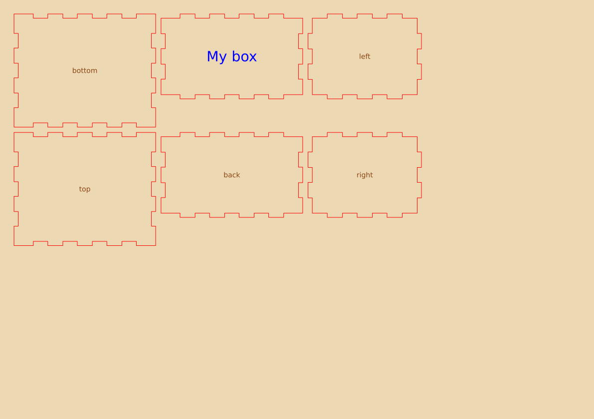

# Project 13: A box from a laser cutter

A laser cutter is a machine that cuts flat sheets of wood, card or acrylic with a beam of light. It follows lines
in a file, so if you can draw the lines, you can make a real thing. In this project you draw the six sides of a box.
Their edges have teeth, called **fingers**, that slot into each other, so the sides lock together into a box. You
choose its size with sliders, put your name on the front, and save a PDF that comes out at its real size. You will
learn about millimetres, path booleans, and what a machine needs from a drawing.

## Run it



The full version is in the gallery. Run it with `python examples/gallery/projects/10_finger_box.py`.

## How it works

**Millimetres.** A machine cuts in real sizes, so everything here is in millimetres. `f.mm(1)` is how many funground
units make one millimetre (about 2.83). Draw a panel in millimetres, then `.scale(f.mm(1))` makes it its real size. A
PDF keeps that size ([chapter 13](../13_saving_your_work.md)): a 100 mm line in the file is cut 100 mm long.

```py
panel = f.path().rect(0, 0, 100, 60)           # 100 by 60, in millimetres
f.draw_path(panel.scale(f.mm(1)))              # drawn at its real size
```

**Fingers.** Two panels meet along an edge. Cut the edge into an odd number of pieces. One panel gets pieces 0, 2, 4
and so on; the other gets pieces 1, 3, 5. Each finger is exactly as long as the sheet is thick, so it fills the gap in
the other panel. Each panel is a rectangle joined to its fingers with `|` (union), which makes one outline.

**Corners.** Where three sides meet, one little corner square belongs to only one of them. The sketch ranks the panels
(bottom and top, then front and back, then the two ends) and gives each corner to the highest. The higher panel on an
edge also gets the even pieces.

**The burn.** The beam burns away a thin line of the sheet, about 0.1 to 0.3 mm wide. This is the **kerf**. Cut
along a line and each piece loses half the kerf on that side, so the fingers come out a little thin and the joint is
loose. The sketch makes every outline bigger by half the kerf before it is saved:

```py
def cut(shape):
    return shape | shape.expand_stroke(KERF, join="miter")
```

`expand_stroke(KERF)` is the shape a line `KERF` wide would paint along the outline: half of it outside, half inside.
`|` adds it on, so the outline grows by half the kerf all round. `join="miter"` keeps the corners square.

**Cut and engrave.** Laser programs sort lines by colour. Here red lines are cut and the blue name is engraved, that
is, burnt into the surface. In the laser program you set what each colour does. The saved frame has no background,
because a cutter would treat a filled rectangle as one more thing to engrave.

## Stage 1: make it work

Two panels that meet along one edge, drawn at their real size and saved as a PDF. The edge is 70 mm long, cut into
seven pieces of 10 mm. The sheet is 3 mm thick.

```python
import funground as f

T = 3          # how thick the sheet is, in mm
PIECES = 7     # the shared edge is cut into 7 pieces
SIZE = 10      # each piece is 10 mm long, so the edge is 70 mm

f.size(f.mm(100), f.mm(110))
first = f.path().rect(0, 0, 70, 40 - T)        # each panel without the strip along the shared edge
second = f.path().rect(0, T, 70, 40 - T)
for k in range(PIECES):
    if k % 2 == 0:
        first = first | f.path().rect(k * SIZE, 40 - T, SIZE, T)     # a finger on the first panel
    else:
        second = second | f.path().rect(k * SIZE, 0, SIZE, T)        # a finger on the second panel

f.no_fill()
f.stroke("red")
f.draw_path(first.translate(10, 10).scale(f.mm(1)))
f.draw_path(second.translate(10, 60).scale(f.mm(1)))
f.save("two_panels.pdf")
f.show()
```

Look at the two edges. Where one has a finger, the other has a gap. Stand them up at a right angle in your head: the
fingers of the bottom of the first fill the gaps in the top of the second.

## Stage 2: make it yours

**A whole box.** A box has six panels and twelve edges. Write a function `panel(w, h, ...)` that makes one panel with
fingers on all four edges, then call it six times. The gallery version does this; its `pieces()` function works out the
pieces along one edge for you.

**Sliders.** `f.create_slider(40, 130, 100, step=1, label="width mm")` lets you change the size. Work the panels out
again in `draw()` from `width.value()`, so the drawing follows the slider.

**Your name.** `f.text_path("Asha", x, y)` gives the outline of some letters. Fill it blue for the engraving.

**A hole.** Cut a round hole in the lid with `-` (difference):

```py
lid = lid - f.path().circle(50, 40, 15)          # a 30 mm hole, for a pencil or a cable
```

**No lid.** Leave the top out and the walls' top edges stay straight: a tray, or a pen pot if you make it tall.

## Stage 3: make it shine

The full version in the gallery has sliders for the width, depth, height and the sheet's thickness, a lid you can tick
off, your name on the front, the kerf allowed for, and a save button that writes `box.pdf` and `box.svg`. Read
`examples/gallery/projects/10_finger_box.py`. The top of the file explains each part.

## Before you cut

- **Use the PDF.** It is the real size. An SVG has no unit on its size, so some programs read it 3/4 as big.
- **Ask an adult** who knows the laser cutter. Many schools, libraries and makerspaces have one.
- **Cut only what the cutter is meant for**: plywood, MDF, card or acrylic. Never cut PVC or vinyl. Burning them gives
  off a poisonous gas.
- **Measure your sheet** and set the thickness slider to it. A "3 mm" sheet is often 2.8 or 3.2.
- **Test a corner first.** Cut two small panels, as in Stage 1. If they are loose, make `KERF` bigger; if they will not
  go together, make it smaller.
- **No laser cutter?** Print the PDF at actual size (not "fit to page") onto thick card, about 2 mm, set the thickness
  to match, and cut along the red lines with a craft knife and a metal ruler.

## Challenge cards

- **The lid.** Make a lid that lifts off: a top panel one sheet bigger all round, with a smaller panel glued under it.
- **Pattern.** Engrave a pattern on the lid instead of a name: a rangoli from [project 2](02_rangoli.md), in blue.
- **Pen pot.** A box 70 by 70 by 100 mm with no lid. Will it tip over when it is full of pencils? What size stops it?
- **Dividers.** Add one panel inside the box. It needs slots in the front and back to stand in. How wide are they?
